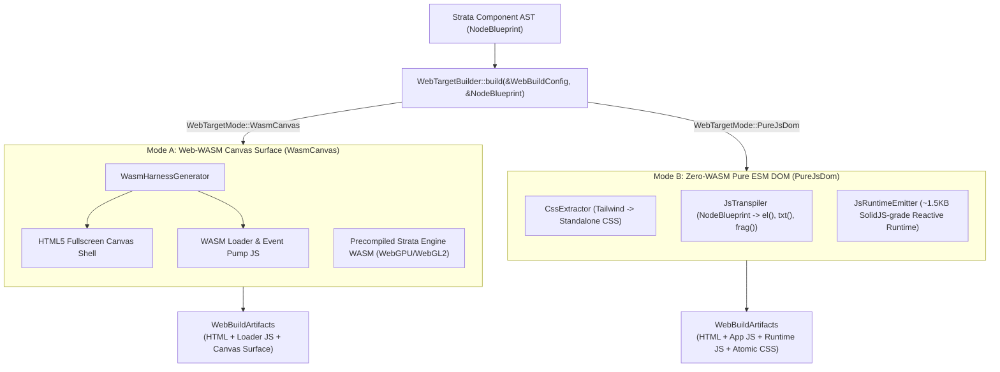
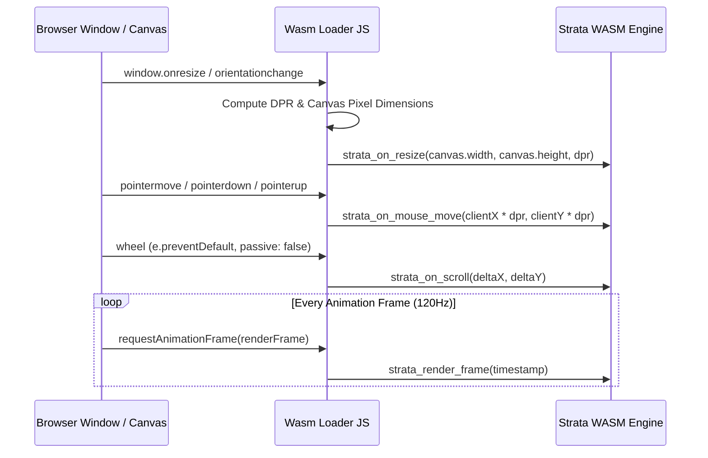

# strata_codegen_js

Dual-Mode Web Compiler: Web-WASM Canvas Engine vs. Zero-WASM Pure ESM JavaScript DOM.

The `strata_codegen_js` crate provides the web compilation infrastructure for Strata. It features a dual-mode compiler architecture capable of generating either a high-performance WebAssembly canvas surface engine (Mode A) or a sub-20KB zero-WASM pure ES Module JavaScript application with a micro-reactive runtime (Mode B).

---

## Architecture Overview

Web deployments typically demand diametric performance characteristics:
- **Graphics-Intensive Platforms**: Complex dashboards, engineering interfaces, 3D spatial viewports, and multi-window environments require predictable 120 FPS rendering, GPU SDF font rasterization, and direct pixel control.
- **Content & Portal Applications**: Marketing landing pages, documentation platforms, and low-latency micro-frontends demand instant First Contentful Paint (FCP < 50ms), zero WebAssembly compilation latency, search engine (SEO) crawlability, and minimal network payload transfer.

`strata_codegen_js` resolves this dilemma by compiling the identical Strata component tree (`NodeBlueprint`) through two distinct compilation pipelines.



---

## Architectural Comparison Matrix

| Architectural Dimension | Mode A: Web-WASM Canvas (`WasmCanvas`) | Mode B: Pure ESM JavaScript (`PureJsDom`) |
| :--- | :--- | :--- |
| **Primary Use Case** | 120 FPS GPU dashboards, games, canvas tools | High-speed web apps, documentation, public portals |
| **Rendering Backend** | WebGPU / WebGL2 via HTML5 Canvas | Browser Native DOM (`HTMLElement`, `SVGElement`) |
| **WASM Dependency** | Required (`.wasm` binary payload) | **Zero WASM** (100% pure vanilla JavaScript ESM) |
| **Initial Bundle Size** | ~1.5MB to 3.5MB (Full Strata Engine WASM) | **< 20KB total** (App code + 1.5KB runtime) |
| **First Contentful Paint (FCP)**| 150ms to 350ms (WASM instantiation + GPU init) | **< 30ms** (Instant browser parsing and mount) |
| **Frame Rate** | Locked 120 FPS native render loop | Browser compositor scheduled |
| **SEO & Crawlability** | Canvas surface (requires SSR fallback) | Standard semantic HTML DOM tree |
| **Text Selection** | Strata SDF text engine & virtual caret | Native browser text selection & copy/paste |

---

## Unified Target Orchestrator (`WebTargetBuilder`)

Compilation is driven through `WebTargetBuilder`:

```rust
use strata_codegen_js::prelude::*;
use strata_dom::NodeBlueprint;

let config = WebBuildConfig {
    mode: WebTargetMode::PureJsDom,
    app_title: "Strata Production Dashboard".to_string(),
    root_element_id: "app".to_string(),
    extract_css: true,
    inline_runtime: false,
    ..Default::default()
};

let blueprint: NodeBlueprint = /* Component Tree */;
let artifacts: WebBuildArtifacts = WebTargetBuilder::build(&config, &blueprint);

println!("Generated HTML:\n{}", artifacts.html);
println!("Generated JS:\n{}", artifacts.js);
if let Some(css) = artifacts.css {
    println!("Extracted Atomic CSS:\n{}", css);
}
```

### Configuration Options (`WebBuildConfig`)

```rust
#[derive(Debug, Clone)]
pub struct WebBuildConfig {
    pub mode: WebTargetMode,
    pub app_title: String,
    pub root_element_id: String,
    pub canvas_element_id: String,
    pub minify: bool,
    pub inline_runtime: bool,
    pub extract_css: bool,
    pub wasm_binary_name: String,
    pub loader_js_name: String,
    pub runtime_js_name: String,
    pub app_js_name: String,
    pub styles_css_name: String,
}
```

---

## Mode A: Web-WASM Canvas Surface Harness

In Mode A, `WasmHarnessGenerator` generates the host page and the event pump bridge connecting browser DOM events to the WebAssembly linear memory engine.



### HiDPI Resolution Synchronization

Displays with fractional device pixel ratios (such as Apple Retina displays at 2.0x or 3.0x scale) produce blurry canvas rendering if dimensions are not synchronized to physical backing pixels:

```javascript
function updateCanvasResolution() {
  const dpr = window.devicePixelRatio || 1;
  const width = window.innerWidth;
  const height = window.innerHeight;
  canvas.width = Math.round(width * dpr);
  canvas.height = Math.round(height * dpr);

  if (wasmInstance && wasmInstance.exports.strata_on_resize) {
    wasmInstance.exports.strata_on_resize(canvas.width, canvas.height, dpr);
  }
}
```

### Event Pumps

- **Pointer & Touch**: Ingests `pointermove`, `pointerdown`, and `pointerup`, scaling client coordinates by `devicePixelRatio`.
- **High-Precision Scroll**: Binds `wheel` with `{ passive: false }` to cancel default browser scrolling and stream `deltaX` / `deltaY` to Strata layout containers.
- **Hardware Keyboard**: Binds `keydown` and `keyup` dispatching key codes along with modifier flags (`shiftKey`, `ctrlKey`, `altKey`).

---

## Mode B: Zero-WASM Pure ESM JavaScript Transpiler

Mode B compiles `NodeBlueprint` component trees directly into standard ECMAScript modules (ESM) that construct and update real DOM nodes without bundling any WebAssembly.

### AST Transpilation (`JsTranspiler`)

`JsTranspiler` recurses over the component tree and emits hyper-optimized DOM creation instructions:

```rust
use strata_codegen_js::transpiler::JsTranspiler;
use strata_dom::NodeBlueprint;

let blueprint = NodeBlueprint::element(
    strata_dom::Tag::Div,
    vec!["flex".to_string(), "bg-slate-900".to_string(), "p-4".to_string()],
    vec![],
    vec![NodeBlueprint::text("Server Active")],
);

let esm_code = JsTranspiler::emit_standalone_app(&blueprint, "root", "./runtime.js");
```

Generated JavaScript:

```javascript
import { el, txt, frag, on, bindText, bindAttr, bindClass, mount } from './runtime.js';

export function App() {
  return el('div', 'flex bg-slate-900 p-4', {}, [
    txt('Server Active')
  ]);
}

if (typeof document !== 'undefined') {
  const root = document.getElementById('root');
  if (root) {
    mount(root, App);
  }
}
```

---

## Micro Reactive Runtime (`JsRuntimeEmitter`)

Mode B includes a self-contained, SolidJS-grade fine-grained reactive runtime measuring approximately 1.5KB uncompressed. It eliminates the Virtual DOM entirely by creating direct closures around real DOM nodes:

```javascript
// Strata Micro Reactive Runtime (Fine-Grained Signals, Zero Virtual DOM)
let activeEffect = null;
let batchDepth = 0;
const pendingEffects = new Set();

export function createSignal(initialValue) {
  let value = initialValue;
  const subscribers = new Set();
  const read = () => {
    if (activeEffect) subscribers.add(activeEffect);
    return value;
  };
  const write = (newValue) => {
    value = typeof newValue === 'function' ? newValue(value) : newValue;
    for (const sub of subscribers) {
      if (batchDepth > 0) pendingEffects.add(sub);
      else sub();
    }
  };
  return [read, write];
}

export function createEffect(fn) {
  const effect = () => {
    const prevEffect = activeEffect;
    activeEffect = effect;
    try {
      fn();
    } finally {
      activeEffect = prevEffect;
    }
  };
  effect();
}
```

### DOM Binding Helpers

- `el(tag, classes, attrs, children)`: Creates an `HTMLElement`, assigns classes, binds event listeners, and attaches children.
- `txt(content)`: Allocates a native `TextNode`.
- `bindText(element, signal)`: Surgically updates `textContent` when the signal mutates without re-rendering parent elements.
- `bindAttr(element, attr, signal)`: Reactively updates HTML attributes.
- `bindClass(element, className, signal)`: Toggles class membership based on boolean signal state.
- `mount(parent, rootComponent)`: Attaches the component tree to the target DOM element.

---

## Atomic CSS Extractor (`CssExtractor`)

When `extract_css: true` is configured, `CssExtractor` parses the component tree, aggregates all unique utility class names, and outputs an optimized stylesheet:

```rust
use strata_codegen_js::css_extractor::CssExtractor;

let classes = CssExtractor::collect_classes(&blueprint);
let css_stylesheet = CssExtractor::generate_stylesheet(&classes);
```

### CSS Selector Escaping

Utility class names containing punctuation (colons for pseudo-classes, brackets for arbitrary values) are automatically escaped:

| Utility Token | Generated CSS Rule |
| :--- | :--- |
| `flex` | `.flex { display: flex; }` |
| `hover:text-blue-300` | `.hover\:text-blue-300:hover { color: #93c5fd; }` |
| `focus:ring-2` | `.focus\:ring-2:focus { box-shadow: 0 0 0 2px currentColor; }` |
| `bg-slate-950` | `.bg-slate-950 { background-color: #020617; }` |
| `w-full` | `.w-full { width: 100%; }` |
| `p-4` | `.p-4 { padding: 1rem; }` |
