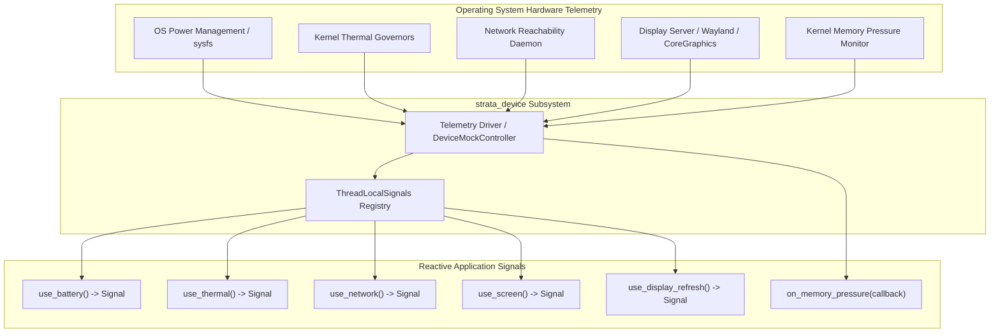

# strata_device

Native Hardware Introspection, Device Telemetry, and Reactive Hardware Signals.

The `strata_device` crate provides a unified, cross-platform telemetry and hardware introspection engine for Strata applications. It translates low-level operating system telemetry into fine-grained reactive signals (`Signal<T>`), enabling user interfaces to respond dynamically to battery levels, thermal throttling, network changes, 120Hz ProMotion displays, and OS memory pressure events.

---

## Architecture Overview

Modern cross-platform applications must adapt dynamically to volatile device operating constraints:
- **Display Variations**: Variable refresh rates (VRR) ranging from 10Hz to 120Hz/144Hz (Apple ProMotion, AMD FreeSync), asymmetric safe area cutouts (notches, Dynamic Island), and wide color gamuts (Display P3).
- **Power and Thermals**: Dynamic CPU/GPU frequency scaling under elevated junction temperatures, requiring immediate degradation of non-essential animation workloads.
- **Network Metering**: Adapting asset preload strategies based on metered cellular data vs. unmetered high-throughput fiber/Wi-Fi.
- **Memory Pressure**: Handling OS memory eviction notifications prior to operating system process termination.

`strata_device` abstracts platform-specific telemetry APIs (Apple IOKit, Android BatteryManager/ThermalService, Linux sysfs/DBus, Windows WinRT/WMI) into thread-local, reactive signals.



---

## Reactive Telemetry Hooks

All hooks return fine-grained `Signal<T>` handles. Reading a signal within a component render function or reactive effect automatically subscribes the caller to hardware updates.

### Battery State (`use_battery`)

Provides real-time battery charge levels, charging states, and operating power modes:

```rust
use strata_device::prelude::*;

fn BatteryMonitor() -> NodeBlueprint {
    let battery = use_battery();

    // Signal read establishes a fine-grained dependency
    let info: BatteryInfo = battery.get();

    let status_color = if info.level < 0.20 && !matches!(info.state, BatteryState::Charging) {
        "text-red-500"
    } else {
        "text-emerald-400"
    };

    println!("Current charge: {:.1}%", info.level * 100.0);
    println!("Power saver mode active: {}", info.is_low_power_mode);

    // Component tree emits with updated telemetry
    rsx! {
        <div class="p-4 bg-slate-900 border border-slate-800 rounded-lg">
            <span class={status_color}>
                {format!("Battery: {:.0}% ({:?})", info.level * 100.0, info.state)}
            </span>
        </div>
    }
}
```

#### `BatteryInfo` Data Structure

```rust
#[derive(Debug, Clone, Copy, PartialEq)]
pub struct BatteryInfo {
    /// Normalized battery level in range [0.0, 1.0].
    pub level: f32,
    /// Operating charge state.
    pub state: BatteryState,
    /// Whether the operating system low power / battery saver mode is active.
    pub is_low_power_mode: bool,
    /// Estimated seconds remaining until battery depletion (if discharging).
    pub time_to_empty_secs: Option<u32>,
    /// Estimated seconds remaining until full charge (if charging).
    pub time_to_full_secs: Option<u32>,
}

#[derive(Debug, Clone, Copy, PartialEq, Eq, Default)]
pub enum BatteryState {
    Charging,
    Discharging,
    #[default]
    Full,
    NotCharging,
    Unknown,
}
```

---

### Thermal Introspection (`use_thermal`)

Exposes device thermal throttling states, allowing runtime applications to dynamically adjust GPU rendering workloads, particle simulations, and frame rate targets:

```rust
use strata_device::prelude::*;

fn PerformanceGovernor() {
    let thermal = use_thermal();

    match thermal.get() {
        ThermalState::Nominal => {
            // Standard execution: 120 FPS target, full post-processing
        }
        ThermalState::Fair => {
            // Elevated heat: engage background thread throttling
        }
        ThermalState::Serious => {
            // Severe thermal throttling: cap display refresh to 60Hz, disable blur shaders
        }
        ThermalState::Critical => {
            // Extreme thermal state: cap to 30Hz, disable 3D viewports, halt background synchronization
        }
    }
}
```

#### `ThermalState` Enumeration

```rust
#[derive(Debug, Clone, Copy, PartialEq, Eq, PartialOrd, Ord, Default)]
pub enum ThermalState {
    /// Normal operating thermal conditions.
    #[default]
    Nominal,
    /// Elevated thermal conditions; active cooling engaged.
    Fair,
    /// Heavy thermal throttling; frame rates should be reduced to 60Hz.
    Serious,
    /// Extreme thermal throttling; immediate power reduction required (cap to 30Hz, halt background tasks).
    Critical,
}
```

---

### Network Status and Bandwidth (`use_network`)

Monitors connection type, metered data status, round-trip time (RTT), and estimated downlink throughput:

```rust
use strata_device::prelude::*;

fn AssetLoader() {
    let network = use_network();
    let status: NetworkStatus = network.get();

    if !status.is_online {
        println!("Device is offline. Falling back to local cache.");
        return;
    }

    if status.is_metered {
        println!("Connection is metered ({:?}). Deferring heavy video preloads.", status.connection_type);
    } else if let Some(downlink) = status.downlink_mbps {
        if downlink > 50.0 {
            println!("High-speed connection detected ({downlink:.1} Mbps). Preloading high-resolution assets.");
        }
    }
}
```

#### `NetworkStatus` Data Structure

```rust
#[derive(Debug, Clone, Copy, PartialEq)]
pub struct NetworkStatus {
    pub is_online: bool,
    pub connection_type: ConnectionType,
    pub cellular_generation: Option<CellularGen>,
    pub downlink_mbps: Option<f32>,
    pub rtt_ms: Option<u32>,
    pub is_metered: bool,
}

#[derive(Debug, Clone, Copy, PartialEq, Eq, Default)]
pub enum ConnectionType {
    #[default]
    Wifi,
    Cellular,
    Ethernet,
    Bluetooth,
    Unknown,
    None,
}

#[derive(Debug, Clone, Copy, PartialEq, Eq)]
pub enum CellularGen {
    TwoG,
    ThreeG,
    FourG,
    FiveG,
}
```

---

### Screen Geometry and Safe Area Insets (`use_screen`)

Returns viewport dimensions, device scale factor (DPI), display color gamut, and notch/bezel safe area insets:

```rust
use strata_device::prelude::*;

fn RootLayout() -> NodeBlueprint {
    let screen = use_screen();
    let geom: ScreenGeometry = screen.get();

    let safe_padding_top = geom.safe_area.top;
    let safe_padding_bottom = geom.safe_area.bottom;

    println!("Display: {}x{} @ {:.2}x scale", geom.width_px, geom.height_px, geom.scale_factor);
    println!("Color Gamut: {:?}", geom.color_gamut);

    rsx! {
        <div style={format!("padding-top: {}px; padding-bottom: {}px;", safe_padding_top, safe_padding_bottom)}
             class="w-full h-full bg-slate-950">
            <!-- App Content -->
        </div>
    }
}
```

#### `ScreenGeometry` and `SafeAreaInsets`

```rust
#[derive(Debug, Clone, Copy, PartialEq)]
pub struct ScreenGeometry {
    pub width_px: u32,
    pub height_px: u32,
    pub scale_factor: f32,
    pub safe_area: SafeAreaInsets,
    pub color_gamut: ColorGamut,
}

#[derive(Debug, Clone, Copy, PartialEq, Default)]
pub struct SafeAreaInsets {
    pub top: f32,
    pub right: f32,
    pub bottom: f32,
    pub left: f32,
}

#[derive(Debug, Clone, Copy, PartialEq, Eq, Default)]
pub enum ColorGamut {
    #[default]
    Srgb,
    DisplayP3,
    Rec2020,
}
```

---

### Display Refresh and ProMotion (`use_display_refresh`)

Tracks dynamic refresh rate changes on variable refresh rate (VRR) panels (such as Apple ProMotion displays capable of dynamic 24Hz-120Hz transitions):

```rust
use strata_device::prelude::*;

fn AnimationScheduler() {
    let refresh = use_display_refresh();
    let info: DisplayRefreshInfo = refresh.get();

    println!("Active refresh rate: {:.1} Hz (Max: {:.1} Hz)", info.current_hz, info.max_hz);
    if info.is_high_refresh_rate {
        println!("120Hz+ ProMotion capability enabled. Activating high-precision micro-animations.");
    }
}
```

#### `DisplayRefreshInfo` Data Structure

```rust
#[derive(Debug, Clone, Copy, PartialEq)]
pub struct DisplayRefreshInfo {
    pub current_hz: f32,
    pub max_hz: f32,
    pub is_variable_refresh_rate: bool,
    pub is_high_refresh_rate: bool,
}
```

---

## GPU Hardware Introspection

Provides hardware driver identity and VRAM resource accounting:

```rust
use strata_device::types::{GpuBackend, GpuInfo};

let gpu = GpuInfo {
    backend: GpuBackend::Vulkan,
    device_name: "NVIDIA GeForce RTX 4090".to_string(),
    driver_version: "550.54.14".to_string(),
    vram_total_bytes: 24 * 1024 * 1024 * 1024,
    vram_used_bytes: 3 * 1024 * 1024 * 1024,
};
```

Supported GPU backends: `Metal`, `Vulkan`, `Direct3D12`, `WebGpu`, `OpenGl`, `Software`.

---

## Memory Pressure Eviction Registry

Operating systems dispatch memory pressure notifications before forcibly terminating background or foreground processes. Applications can register callbacks to purge discardable memory:

```rust
use strata_device::prelude::*;

// Register an eviction listener
let listener_id = on_memory_pressure(|level| {
    match level {
        MemoryPressure::Normal => {}
        MemoryPressure::Warning => {
            println!("Memory pressure WARNING: Evacuating image caches and glyph atlases.");
            // Purge texture caches
        }
        MemoryPressure::Critical => {
            eprintln!("Memory pressure CRITICAL: Emergency eviction of all non-essential allocations.");
            // Force shrink caches to zero capacity
        }
    }
});

// Unregister listener when component unmounts
unregister_memory_pressure(listener_id);
```

---

## Simulation and Testing Controller (`DeviceMockController`)

For continuous integration, unit tests, and headless simulators, `DeviceMockController` provides a thread-safe simulation handle to programmatically manipulate all telemetry states:

```rust
use strata_device::prelude::*;

#[test]
fn test_battery_depletion_workflow() {
    let controller = DeviceMockController::new();

    // Reset all mock telemetry to standard defaults
    controller.reset_to_defaults();

    // Verify initial battery
    let battery_sig = use_battery();
    assert_eq!(battery_sig.get().level, 1.0);

    // Simulate battery dropping to 15%
    controller.set_battery_level(0.15);
    assert_eq!(battery_sig.get().level, 0.15);

    // Simulate entering critical thermal throttling
    controller.set_thermal(ThermalState::Critical);
    let thermal_sig = use_thermal();
    assert_eq!(thermal_sig.get(), ThermalState::Critical);

    // Trigger mock memory pressure event
    controller.trigger_memory_pressure(MemoryPressure::Critical);
}
```
