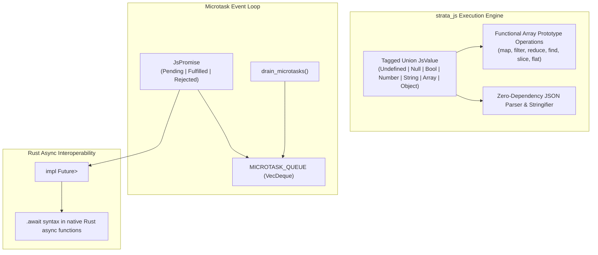
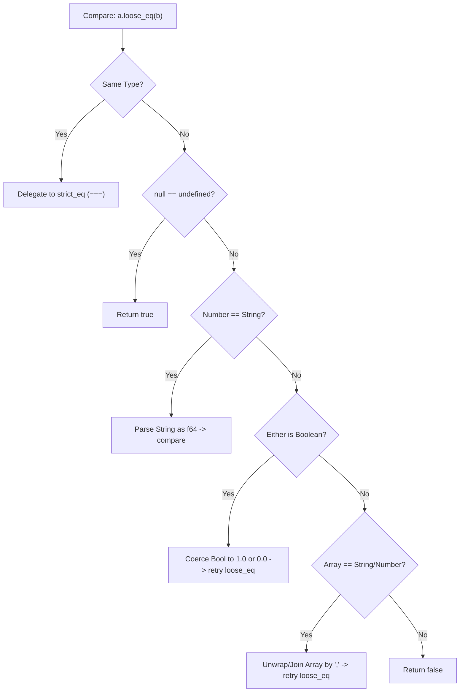

# strata_js

Zero-V8 Hybrid JavaScript Runtime, Dynamic Typing, and Promise Event Loop in Safe Rust.

The `strata_js` crate provides a zero-dependency, pure-Rust execution layer that ports modern JavaScript frontend paradigms, dynamic typing (`JsValue`), array prototype methods, cooperative microtask scheduling, and standard Web APIs directly into safe Rust. It enables developers to write web-ergonomic code without bundling V8, WebKit, or JavaScriptCore.

---

## Architecture Overview

Embedding standard JavaScript engines (such as Google V8 or JavaScriptCore) into cross-platform desktop or cloud infrastructure binaries incurs severe costs:
- **Massive Binary Bloat**: V8 adds 30MB to 50MB of compiled binary weight.
- **JIT & Security Restrictions**: iOS and various hardened server environments forbid executable memory (`W^X` / W^X violation on unsigned JIT pages).
- **Garbage Collection Pauses**: Non-deterministic stop-the-world GC cycles induce frame stutter and latency spikes.
- **Foreign Function Interface (FFI) Overhead**: Marshaling data between Rust and V8 handles across the C-FFI barrier dominates CPU profiles.

`strata_js` implements a zero-V8 architecture:
1. **Tagged Union Dynamic Typing (`JsValue`)**: Native Rust representations for JavaScript types with zero GC overhead.
2. **Deterministic Microtask Scheduler**: A thread-local queue executing Promise resolution callbacks cooperatively.
3. **Native Rust `Future` Integration**: `JsPromise<T>` directly implements `std::future::Future`, enabling seamless interop with Rust async/await runtimes.



---

## Dynamic Typing (`JsValue`)

The core of `strata_js` is the `JsValue` tagged union:

```rust
use std::collections::BTreeMap;

#[derive(Debug, Clone, PartialEq)]
pub enum JsValue {
    Undefined,
    Null,
    Bool(bool),
    Number(f64),
    String(String),
    Array(Vec<JsValue>),
    Object(BTreeMap<String, JsValue>),
}
```

### Type Checking and Inspections

`JsValue` accurately replicates JavaScript specification behaviors, including historical language quirks:

```rust
use strata_js::prelude::*;

assert_eq!(JsValue::Undefined.js_typeof(), "undefined");
assert_eq!(JsValue::Null.js_typeof(), "object"); // Canonical JS specification quirk
assert_eq!(JsValue::Bool(true).js_typeof(), "boolean");
assert_eq!(JsValue::Number(42.0).js_typeof(), "number");
assert_eq!(JsValue::String("hello".into()).js_typeof(), "string");
assert_eq!(JsValue::Array(vec![]).js_typeof(), "object");
assert_eq!(JsValue::Object(BTreeMap::new()).js_typeof(), "object");
```

### Truthiness Evaluation (`is_truthy`)

Accurately adheres to ECMAScript truthy/falsy conventions:
- **Falsy**: `Undefined`, `Null`, `Bool(false)`, `Number(0.0)`, `Number(NaN)`, `String("")`.
- **Truthy**: `Bool(true)`, non-zero/non-NaN numbers, non-empty strings, all `Array`s (even empty `[]`), all `Object`s (even empty `{}`).

```rust
use strata_js::prelude::*;

assert!(!JsValue::Undefined.is_truthy());
assert!(!JsValue::Null.is_truthy());
assert!(!JsValue::Number(0.0).is_truthy());
assert!(!JsValue::Number(f64::NAN).is_truthy());
assert!(!JsValue::String("".into()).is_truthy());

assert!(JsValue::Bool(true).is_truthy());
assert!(JsValue::Number(-1.0).is_truthy());
assert!(JsValue::String("0".into()).is_truthy());
assert!(JsValue::Array(vec![]).is_truthy()); // In JS, [] is truthy
```

---

## Equality Semantics (`strict_eq` vs `loose_eq`)

`strata_js` provides explicit implementations for both JavaScript strict equality (`===`) and abstract loose equality (`==`).



### Strict Equality (`strict_eq` / `===`)
- Different types return `false`.
- `NaN === NaN` returns `false` (standard IEEE 754 invariance).
- Arrays and Objects undergo deep structural equality.

### Abstract Loose Equality (`loose_eq` / `==`)
- `null == undefined` evaluates to `true`.
- Compares numbers and strings by parsing the string to `f64`.
- Booleans are coerced to `1.0` (`true`) or `0.0` (`false`).
- Arrays are joined with commas when compared against primitives.

```rust
use strata_js::prelude::*;

// Strict Equality (===)
assert!(JsValue::Null.strict_eq(&JsValue::Null));
assert!(!JsValue::Null.strict_eq(&JsValue::Undefined));
assert!(!JsValue::Number(f64::NAN).strict_eq(&JsValue::Number(f64::NAN)));

// Loose Equality (==)
assert!(JsValue::Null.loose_eq(&JsValue::Undefined));
assert!(JsValue::Number(42.0).loose_eq(&JsValue::String("42".into())));
assert!(JsValue::Bool(true).loose_eq(&JsValue::Number(1.0)));
assert!(JsValue::Bool(true).loose_eq(&JsValue::String("1".into())));
```

---

## JavaScript Array Prototype Methods

All common JavaScript array prototype functions are implemented directly on `JsValue`:

```rust
use strata_js::prelude::*;

let numbers = JsValue::Array(vec![
    JsValue::Number(1.0),
    JsValue::Number(2.0),
    JsValue::Number(3.0),
    JsValue::Number(4.0),
    JsValue::Number(5.0),
]);

// Array.prototype.map
let doubled = numbers.map(|x| JsValue::Number(x.as_f64().unwrap() * 2.0));

// Array.prototype.filter
let evens = numbers.filter(|x| x.as_f64().unwrap() % 2.0 == 0.0);

// Array.prototype.reduce
let sum = numbers.reduce(|acc, item| {
    JsValue::Number(acc.as_f64().unwrap() + item.as_f64().unwrap())
}, JsValue::Number(0.0));
assert_eq!(sum.as_f64(), Some(15.0));

// Array.prototype.find and findIndex
let found = numbers.find(|x| x.as_f64() == Some(3.0));
assert_eq!(found, Some(&JsValue::Number(3.0)));

let found_idx = numbers.find_index(|x| x.as_f64() == Some(3.0));
assert_eq!(found_idx, Some(2));

// Array.prototype.slice, join, flat
assert_eq!(numbers.slice(1, Some(3)).len(), 2);
assert_eq!(numbers.join(", "), "1, 2, 3, 4, 5");
```

---

## Static Object Utilities (`JsObject`)

The `JsObject` utility mimics static methods on the JavaScript `Object` constructor:

```rust
use strata_js::prelude::*;
use std::collections::BTreeMap;

let mut obj = JsValue::Object(BTreeMap::new());
obj.set_property("cluster_name", "us-east-prod");
obj.set_property("nodes", 64.0);

// Object.keys
let keys: Vec<String> = JsObject::keys(&obj);
assert_eq!(keys, vec!["cluster_name".to_string(), "nodes".to_string()]);

// Object.values
let vals: Vec<JsValue> = JsObject::values(&obj);

// Object.entries
let entries: Vec<(String, JsValue)> = JsObject::entries(&obj);

// Object.assign
let mut target = JsValue::Object(BTreeMap::new());
JsObject::assign(&mut target, &obj);
assert_eq!(target["cluster_name"].as_str(), Some("us-east-prod"));
```

---

## Cooperative Microtask Queue & `JsPromise<T>`

`strata_js` implements a cooperative microtask scheduler. Promises resolve their callbacks via the thread-local microtask queue, guaranteeing deterministic scheduling order identical to the JavaScript event loop.

```rust
use strata_js::prelude::*;

// 1. Queue a manual microtask
queue_microtask(|| {
    println!("Executed inside microtask checkpoint");
});

// 2. Create a Promise with resolve / reject callbacks
let promise: JsPromise<String> = JsPromise::new(|resolve, _reject| {
    resolve("Cluster Initialized".to_string());
});

// 3. Chain with then()
let chained = promise
    .then(|val| format!("{val} -> Metrics Active"))
    .then(|val| format!("{val} -> Ready"));

// 4. Drain microtasks to settle chained callbacks
let tasks_fired = drain_microtasks();
println!("Executed {tasks_fired} microtasks");

assert_eq!(chained.state(), PromiseState::Fulfilled("Cluster Initialized -> Metrics Active -> Ready".to_string()));
```

### Promise Combinators (`Promise.all` & `Promise.race`)

```rust
use strata_js::prelude::*;

let p1 = JsPromise::resolve(10);
let p2 = JsPromise::resolve(20);
let p3 = JsPromise::resolve(30);

// Promise.all: Resolves when all resolve, rejects if any rejects
let all_promise = JsPromise::all(vec![p1, p2, p3]);
drain_microtasks();

assert_eq!(all_promise.state(), PromiseState::Fulfilled(vec![10, 20, 30]));
```

### Native Rust `Future` Implementation

Because `JsPromise<T>` implements `std::future::Future`, promises can be directly awaited inside standard Rust asynchronous tasks:

```rust
use strata_js::prelude::*;

async fn initialize_subsystems() -> Result<String, JsValue> {
    let promise = JsPromise::resolve("Telemetry Online".to_string());
    
    // Direct .await on JsPromise
    let result = promise.await?;
    Ok(result)
}
```

---

## Zero-Dependency JSON Parser and Serializer

The crate includes an allocation-conscious recursive descent parser for JSON without external dependencies:

```rust
use strata_js::prelude::*;

let json_text = r#"{"name": "worker-4", "active": true, "load": 0.42}"#;

// Parse directly to JsValue
let val = parse_json(json_text).expect("Valid JSON");
assert_eq!(val["name"].as_str(), Some("worker-4"));
assert_eq!(val["active"].as_bool(), Some(true));

// Serialize back to JSON
let output_json = stringify_json(&val);
```

---

## High-Resolution Timers (`setTimeout` & `setInterval`)

Implements the standard Web Timers specification using a thread-local scheduler with support for deterministic time dilation:

```rust
use strata_js::prelude::*;
use std::time::Duration;
use std::rc::Rc;
use std::cell::Cell;

let counter = Rc::new(Cell::new(0));
let counter_clone = Rc::clone(&counter);

let timer_id = set_timeout(move || {
    counter_clone.set(counter_clone.get() + 1);
}, 500);

// Advance simulated clock instantly without sleep (essential for instant unit testing)
let fired = advance_timers_by(Duration::from_millis(500));
assert_eq!(fired, 1);
assert_eq!(counter.get(), 1);
```
