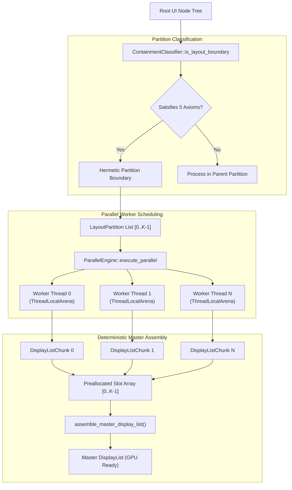
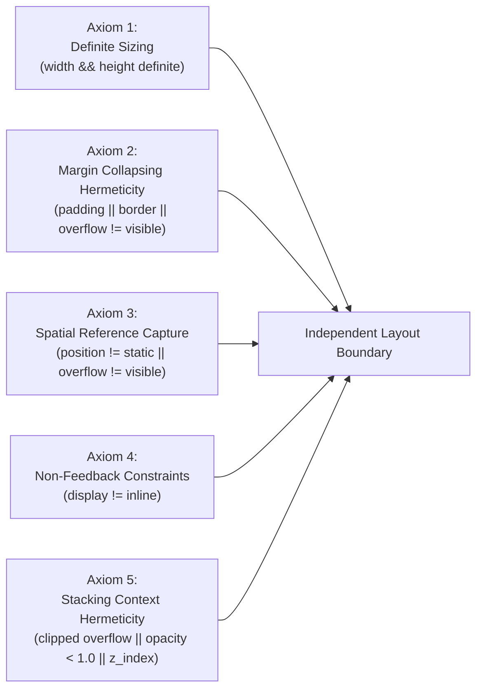

# strata_parallel

Parallel Subtree Layout Computation, 5 Axioms of Containment, and Deterministic Display List Assembly.

The `strata_parallel` crate provides a multi-threaded parallel reconciliation and layout engine for Strata. By partitioning the application UI scene graph into hermetic, mutually independent layout subtrees, `strata_parallel` computes styling, flexbox/grid layout constraints, and draw command buffers concurrently across logical CPU cores.

---

## Architecture Overview

Traditional browser layout engines (such as WebKit and Chromium's Blink) execute layout, style calculation, and render tree mutation serially on a single main UI thread. This architectural choice stems from CSS specification entanglements:
- **Geometry Bleed**: Changing a descendant's width or height can alter parent dimensions, reflowing siblings and ancestors.
- **Margin Collapsing**: Vertical margins bleed through parent boundaries unless explicit borders or padding intervene.
- **Global Positioning Dependencies**: Absolutely positioned descendants resolve against ancestral containing blocks, breaking encapsulation.

`strata_parallel` breaks the single-thread bottleneck by establishing rigorous mathematical boundaries termed the **5 Axioms of Layout Containment**. Subtrees that fulfill these axioms are guaranteed to be geometry-invariant with respect to parent and sibling nodes. The engine dispatches these subtrees to concurrent worker threads and reassembles their visual output into a master display list in deterministic $O(K)$ time without sorting.



---

## The 5 Axioms of Layout Containment

A layout boundary is defined as an isolated subtree whose internal sizing and styling computations cannot alter the geometry of its ancestors or siblings.

The `ContainmentClassifier` evaluates each candidate node against the 5 Axioms of Layout Containment:

```rust
use strata_parallel::containment::ContainmentClassifier;
use strata_style::ComputedStyle;

let is_boundary = ContainmentClassifier::is_layout_boundary(
    &computed_style,
    width_definite,
    height_definite,
);
```

### Mathematical Definitions of the 5 Axioms



#### 1. Axiom 1: Sizing Definiteness and Content Invariance
The node must possess definite width and height dimensions specified in physical pixels or percentage of a known parent constraint:
$$\text{Axiom}_1 \iff \text{width\_definite} \land \text{height\_definite}$$
Descendant additions, text mutations, or layout changes cannot resize the boundary box.

#### 2. Axiom 2: Margin Collapsing Hermeticity
The boundary must prevent vertical margin bleed between descendants and ancestors:
$$\text{Axiom}_2 \iff (\text{padding.top} > 0 \lor \text{padding.bottom} > 0 \lor \text{border.top} > 0 \lor \text{border.bottom} > 0) \lor (\text{overflow} \neq \text{Visible})$$

#### 3. Axiom 3: Spatial Reference and Coordinate Capture
The node must establish a containing block for all absolute and fixed descendant elements:
$$\text{Axiom}_3 \iff (\text{position} \neq \text{Static}) \lor (\text{overflow} \neq \text{Visible})$$

#### 4. Axiom 4: Non-Feedback Parent Constraints
The element must not participate in inline text formatting context or inline line-breaking:
$$\text{Axiom}_4 \iff \text{display} \neq \text{Inline}$$

#### 5. Axiom 5: Stacking Context and Clipping Hermeticity
The node must establish an isolated visual compositing layer:
$$\text{Axiom}_5 \iff (\text{overflow} \neq \text{Visible}) \lor (\text{opacity} < 1.0) \lor (\text{z\_index} \neq \text{None})$$

When all five axioms hold simultaneously:
$$\text{IsLayoutBoundary} \iff \text{Axiom}_1 \land \text{Axiom}_2 \land \text{Axiom}_3 \land \text{Axiom}_4 \land \text{Axiom}_5$$

---

## Parallel Execution Engine (`ParallelEngine`)

The `ParallelEngine` manages worker execution across available CPU cores:

```rust
use strata_parallel::prelude::*;

// Initialize engine automatically matching hardware concurrency
let engine = ParallelEngine::new();
println!("Parallel layout workers initialized: {}", engine.thread_count());
```

### Partition Dispatch Pipeline

```rust
use strata_parallel::engine::{LayoutConstraints, LayoutPartition, ParallelEngine};
use strata_dom::NodeId;

let partitions = vec![
    LayoutPartition {
        partition_id: PartitionId(0),
        origin: (0.0, 0.0),
        constraints: LayoutConstraints {
            available_width: 1920.0,
            available_height: 1080.0,
            device_pixel_ratio: 1.0,
        },
        z_index: 0,
        node_id: NodeId(101),
    },
    LayoutPartition {
        partition_id: PartitionId(1),
        origin: (400.0, 100.0),
        constraints: LayoutConstraints {
            available_width: 600.0,
            available_height: 800.0,
            device_pixel_ratio: 1.0,
        },
        z_index: 10,
        node_id: NodeId(205),
    },
];

// Execute layout reconciliation across threads concurrently
let slots = engine.execute_parallel(&partitions, |partition| {
    // Worker thread computation
    let mut commands = Vec::new();
    // Compute layout using thread-local arena...
    commands
});
```

---

## Deterministic $O(K)$ Master Assembly

In traditional parallel graphics systems, recombining multi-threaded draw calls requires a global sorting step based on $Z$-index or depth buffer calculations. This sort adds $O(N \log N)$ computational overhead where $N$ is the total number of draw commands.

`strata_parallel` eliminates sorting completely:
1. Partitions are enumerated in depth-first hierarchical order `0..K-1` during the containment classification stage.
2. The `execute_parallel` function allocates a fixed slot array `Vec<Option<DisplayListChunk>>` with length $K$.
3. When worker threads complete a partition chunk, they place the result directly into slot index `partition.partition_id.0`.
4. `assemble_master_display_list` traverses slots linearly from `0` to $K-1$, applying spatial affine translation (`dx`, `dy`) in $O(K)$ time:

```rust
let master_display_list = engine.assemble_master_display_list(&slots);
```

### Spatial Translation (`translate_draw_command`)

Every draw command emitted by a worker operates in local partition coordinates `(0, 0)`. During master assembly, `translate_draw_command` applies the partition's physical origin:

```rust
use strata_parallel::engine::translate_draw_command;
use strata_render::DrawCommand;
use strata_layout::Rect;

let local_command = DrawCommand::DrawRect {
    bounds: Rect::new(10.0, 10.0, 100.0, 50.0),
    color: [1.0, 0.0, 0.0, 1.0],
};

let global_command = translate_draw_command(&local_command, (400.0, 100.0));
// Resulting bounds: Rect(410.0, 110.0, 100.0, 50.0)
```

---

## Cache-Aligned Arena (`ThreadLocalArena`)

Worker threads construct temporary layout boxes, flex items, and text runs using `ThreadLocalArena`.

```rust
use strata_parallel::arena::ThreadLocalArena;

// Allocate 1MB thread-local arena
let mut arena = ThreadLocalArena::new(1024 * 1024);

// Bump allocate an item
let item_ref = arena.alloc(42u64);
assert_eq!(*item_ref, 42);

// Reset pointer in 1 CPU cycle for the next frame
arena.reset();
```

### Hardware Alignment and SIMD Sentry Padding

- **64-Byte Cache Line Alignment**: `#[repr(align(64))]` prevents false sharing between worker CPU cores.
- **32-Byte SIMD Sentry Padding**: Allocates 32 extra zeroed bytes past the buffer end. Vectorized string parsing and SIMD flexbox solvers can safely execute 256-bit AVX2/NEON reads past the final payload byte without triggering page faults.
- **1-Cycle Reset**: `reset()` simply rewinds the pointer to the base address without releasing virtual memory back to the kernel.

---

## Wait-Free Dirty Signal Queue (`DirtySignalQueue`)

When reactive signals mutate on background workers (e.g. streaming WebSocket packets or hardware telemetry updates), they must notify the main UI loop without acquiring mutexes.

`DirtySignalQueue` provides a wait-free Multi-Producer Single-Consumer (MPSC) atomic ring buffer:

```rust
use strata_parallel::prelude::*;

let queue = DirtySignalQueue::new(1024);

// Producer thread: wait-free atomic push
let success = queue.push(42);
assert!(success);

// Consumer UI thread: batch drain into bitset for O(1) membership testing
let mut bitset = vec![0u64; 16];
let drained_count = queue.drain_into_bitset(&mut bitset);

// Test whether Signal 42 was dirtied
let word_idx = 42 / 64;
let bit_idx = 42 % 64;
let is_dirty = (bitset[word_idx] & (1u64 << bit_idx)) != 0;
assert!(is_dirty);
```

### Cache-Line False Sharing Prevention

```rust
#[repr(align(64))]
pub struct DirtySignalQueue {
    buffer: Box<[AtomicU32]>,
    capacity: usize,
    mask: usize,
    head: AtomicUsize,
    _pad0: [u8; 56], // Isolates head to its own 64-byte L1 cache line
    tail: AtomicUsize,
    _pad1: [u8; 56], // Isolates tail to its own 64-byte L1 cache line
}
```

The 56-byte padding arrays guarantee that concurrent atomic increments on `head` by producer worker threads never invalidate the L1/L2 cache line holding `tail` on the consumer UI thread.
