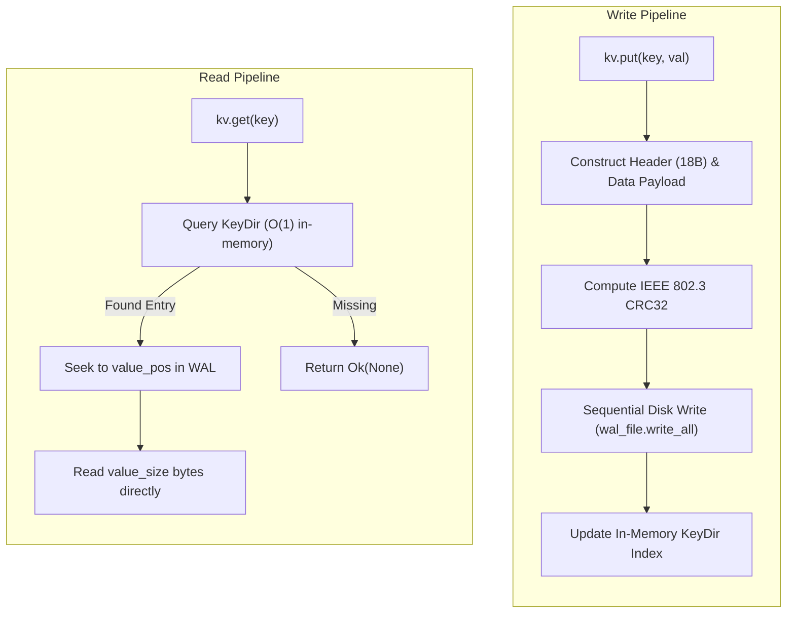
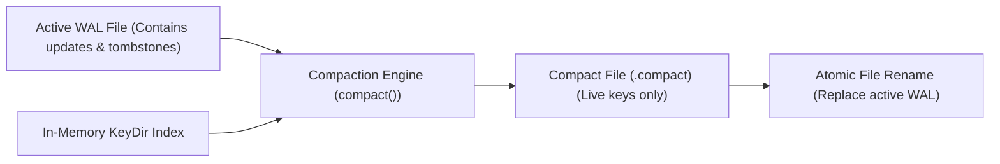

# strata_storage

Pure-Rust Bitcask WAL Engine, In-Memory Storage, and Hardware Keystore.

The `strata_storage` crate provides a zero-dependency, crash-resilient storage architecture for Strata runtime applications. It implements an append-only Write-Ahead Log (WAL) key-value engine modeled after Bitcask, high-level browser-compatible storage abstractions (`LocalStorage` and `SessionStorage`), and a hardware-bound cryptographic keystore.

---

## Architecture Overview

Traditional cross-platform desktop and mobile storage layers often depend on embedded relational engines like SQLite or LSM-tree databases like RocksDB. While versatile, these engines present notable engineering tradeoffs:
- **Binary Footprint Overhead**: SQLite adds over 1.2MB of uncompressed binary size, while RocksDB introduces multi-megabyte C++ compilation chains and shared library dependencies.
- **Random Disk Write Contention**: B-Tree page splits and LSM write-amplification cause random I/O overhead that degrades flash memory life cycles on embedded devices.
- **Lock Contention**: Concurrency bottlenecks on disk-level file locks.

`strata_storage` eliminates external dependencies through a pure-Rust Bitcask log-structured design:
1. **Append-Only Sequential Writes**: All mutations (inserts, updates, tombstones) are written sequentially to the active disk log file, saturating sequential NVMe and SSD bandwidth.
2. **In-Memory Hash Index (`KeyDir`)**: Active key offsets and sizes reside in memory, delivering $O(1)$ reads requiring exactly one disk seek.
3. **Crash Recovery**: Corrupted or incomplete record tails resulting from unexpected power loss are identified and safely truncated during startup replay using IEEE 802.3 CRC32 verification.



---

## On-Disk Binary Format

Every record appended to the WAL adheres to a strict binary format:

```
+--------------------+---------------------+--------------------+--------------------+--------------------+--------------------+
| CRC32 Checksum     | Timestamp           | Key Length         | Value Length       | Key Bytes          | Value Bytes        |
| 4 Bytes (u32 LE)   | 8 Bytes (u64 LE)    | 2 Bytes (u16 LE)   | 4 Bytes (u32 LE)   | Variable (key_len) | Variable (val_len) |
+--------------------+---------------------+--------------------+--------------------+--------------------+--------------------+
|<-------------------------------- Header: 18 Bytes -------------------------------->|<------------ Data Payload ------------>|
```

### Binary Field Specifications

| Offset | Field | Type | Description |
| :--- | :--- | :--- | :--- |
| `0x00..0x04` | `crc32` | `u32` (Little Endian) | IEEE 802.3 CRC32 checksum computed over bytes `0x04..end`. |
| `0x04..0x0C` | `timestamp` | `u64` (Little Endian) | Milliseconds elapsed since UNIX Epoch (`1970-01-01T00:00:00Z`). |
| `0x0C..0x0E` | `key_len` | `u16` (Little Endian) | Byte length of the UTF-8 key string (maximum 65,535 bytes). |
| `0x0E..0x12` | `val_len` | `u32` (Little Endian) | Byte length of the value payload, or tombstone flag. |
| `0x12..` | `key` | `[u8; key_len]` | Raw UTF-8 key bytes. |
| `0x12+key_len..` | `value` | `[u8; val_len]` | Raw arbitrary value payload (omitted if tombstone). |

### Tombstone Records for Deletions

Deletions do not rewrite existing log entries in place. Instead, a tombstone record is appended to the WAL with `val_len` set to `0xFFFF_FFFF` (`TOMBSTONE_VAL_LEN`). During replay and compaction, encountering a tombstone record purges the key from the active memory index.

---

## In-Memory Index (`KeyDirEntry`)

The in-memory index maps key strings to physical file offsets:

```rust
#[derive(Debug, Clone, Copy, PartialEq, Eq)]
pub struct KeyDirEntry {
    /// Byte offset within the WAL file where the value begins.
    pub value_pos: u64,
    /// Exact byte size of the value payload.
    pub value_size: u32,
    /// Timestamp of the record insertion.
    pub timestamp: u64,
}
```

Because `value_pos` directly points to the start of the value payload (bypassing the 18-byte header and key bytes), retrieval requires a single `seek(SeekFrom::Start(value_pos))` followed by a `read_exact` of `value_size` bytes.

---

## WAL Replay and Crash Recovery

When opening a database via `StrataKV::open(path)`, the engine automatically performs a forward replay of the WAL:

```rust
use strata_storage::StrataKV;

let mut kv = StrataKV::open("vfs/app_data/telemetry.wal")?;
```

### Replay Lifecycle

1. The file pointer seeks to offset `0`.
2. The engine reads 18-byte headers sequentially in a loop.
3. For each record, the payload (`key_bytes + val_bytes`) is read into memory.
4. The expected CRC32 is compared against the actual CRC32 computed over `timestamp + key_len + val_len + payload`.
5. **Recovery on Corruption**: If a CRC32 mismatch occurs (caused by a torn write or power interruption mid-append), replay halts immediately. The valid preceding records remain intact in the in-memory index, and future appends will resume safely from the end of the last validated entry.
6. The file cursor seeks to `SeekFrom::End(0)` to prepare for subsequent append operations.

---

## Compaction Mechanism

Because the WAL is append-only, updating or deleting keys creates dead bytes in the active log file over time. The `compact()` method reclaims disk space by writing out a streamlined, compacted WAL:



```rust
use strata_storage::StrataKV;

let mut kv = StrataKV::open("state.wal")?;

// Compaction writes live keys to state.compact, flushes, and atomically renames
kv.compact()?;
```

### Compaction Execution Steps

1. Creates a temporary file adjacent to the WAL (`<wal_path>.compact`).
2. Iterates over active keys in the in-memory `key_dir`.
3. Reads each live value from the old WAL using `entry.value_pos`.
4. Appends clean records into the compaction file with freshly computed CRC32 headers.
5. Flushes the compaction file to disk.
6. Atomically replaces the old WAL file with the compacted file using `std::fs::rename`.
7. Rebinds the active `wal_file` handle and updates all `value_pos` pointers in `key_dir`.

---

## High-Level Web-Compatible Storage

For general application state, `strata_storage` provides `LocalStorage` and `SessionStorage`.

### `LocalStorage` (Memory Cached + WAL Backed)

`LocalStorage` combines instant, zero-latency in-memory reads via `RwLock<HashMap<String, String>>` with background durability via `Mutex<StrataKV>`:

```rust
use strata_storage::local;

let storage = local();

// Writes update in-memory cache and append to storage.wal
storage.set("theme", "dark");
storage.set("user_id", "usr_998124");

// Instant O(1) in-memory read
if let Some(theme) = storage.get("theme") {
    println!("Active theme: {theme}");
}

// Remove entry
storage.remove("user_id");

// Trigger compaction when necessary
storage.compact().expect("Compaction failed");
```

### `SessionStorage` (Volatile In-Memory Storage)

`SessionStorage` maintains state in memory for the lifetime of the process without touching disk:

```rust
use strata_storage::session;

let session_store = session();
session_store.set("session_token", "abc-123-xyz");
assert_eq!(session_store.get("session_token"), Some("abc-123-xyz".to_string()));
```

---

## Hardware Secure Keystore (`SecureKeystore`)

For sensitive credentials, authentication tokens, and private cryptographic keys, `strata_storage` provides `SecureKeystore`. It stores credentials encrypted at rest using machine-bound hardware keys and rolling keystream transformations.

```rust
use strata_storage::keystore::SecureKeystore;

// Store an authentication secret
let token = b"eyJhbGciOiJIUzI1NiIsInR5cCI6IkpXVCJ9.secret";
SecureKeystore::set_secret("auth_bearer_token", token)?;

// Retrieve the secret
if let Some(decrypted_secret) = SecureKeystore::get_secret("auth_bearer_token")? {
    println!("Retrieved secret token (length: {} bytes)", decrypted_secret.len());
}

// Check existence without full deserialization
if SecureKeystore::has_secret("auth_bearer_token") {
    // Delete secret from enclave
    SecureKeystore::delete_secret("auth_bearer_token")?;
}
```

### Machine-Bound Master Key Derivation

The master key is derived at runtime from machine hardware seeds (`MACHINE_ID`, `HOSTNAME`, `USER`):

```rust
// Derivation mixes machine identity into a 32-byte key
// followed by 32 rounds of bit mixing and CRC32 permutation
```

The ciphertext is protected by a rolling XOR keystream combined with an IEEE 802.3 CRC32 verification header. If the ciphertext has been tampered with or transferred to a different machine, the CRC32 check fails with `KeystoreError::DecryptionError`.

### Testing and Mock Configuration

For unit tests and isolated CI environments, the keystore destination path can be explicitly redirected:

```rust
use strata_storage::keystore::SecureKeystore;
use std::env::temp_dir;

#[test]
fn test_keystore_isolation() {
    let test_path = temp_dir().join("test_keystore.enc");
    SecureKeystore::set_keystore_path(test_path.clone());

    SecureKeystore::set_secret("api_key", b"12345").unwrap();
    assert_eq!(SecureKeystore::get_secret("api_key").unwrap(), Some(b"12345".to_vec()));

    SecureKeystore::clear_keystore_path();
    let _ = std::fs::remove_file(test_path);
}
```

---

## Error Handling (`KeystoreError`)

```rust
#[derive(Debug, Clone, PartialEq, Eq)]
pub enum KeystoreError {
    NotFound(String),
    EncryptionError(String),
    DecryptionError(String),
    IoError(String),
}
```
