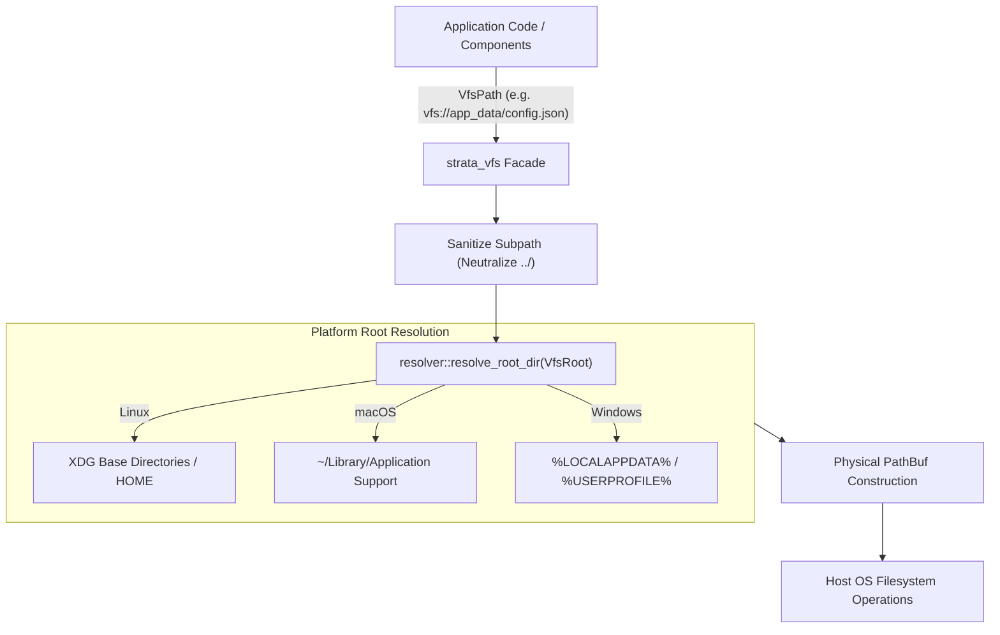

# strata_vfs

Universal, Sandboxed Asynchronous Virtual File System with Zero Platform Conditionals.

The `strata_vfs` crate provides a unified, cross-platform filesystem abstraction layer for the Strata engine. It eliminates conditional compilation directives (`#[cfg(...)]`) in user application code by standardizing file access boundaries across desktop operating systems (Linux, macOS, Windows) and sandboxed environments (mobile and web).

---

## Architecture Overview

Cross-platform filesystem access presents significant engineering friction:
- **Path Separators and Format Quirks**: POSIX forward slashes (`/`) versus Windows backslashes (`\`) and drive prefixes (`C:\`).
- **Permission Models**: POSIX permissions, Android Scoped Storage, and iOS application container boundaries.
- **Web Sandboxes**: Ephemeral memory filesystems, IndexedDB wrappers, and the Origin Private File System (OPFS).
- **Directory Traversal Vulnerabilities**: Malicious relative paths (such as `../../etc/passwd`) escaping container boundaries.

`strata_vfs` addresses these challenges by anchoring all input/output operations to four standardized virtual filesystem roots. Paths are strictly validated and normalized at the driver boundary, preventing directory traversal attacks while preserving native filesystem performance.



---

## Virtual Roots (`VfsRoot`)

The `VfsRoot` enumeration defines the canonical top-level boundaries available to an application:

```rust
#[derive(Debug, Clone, Copy, PartialEq, Eq, Hash)]
pub enum VfsRoot {
    /// Persistent application configuration, state, and user databases.
    AppData,
    /// Discardable cached files, compiled assets, and temporary network downloads.
    Cache,
    /// User documents, exported projects, and media files.
    Documents,
    /// Transient scratch data discarded on session termination.
    Temp,
}
```

### Physical Location Mapping

| Virtual Root | Linux (XDG Compliant) | macOS Standard | Windows Architecture |
| :--- | :--- | :--- | :--- |
| **`AppData`** | `$XDG_DATA_HOME/<app_id>` or `~/.local/share/<app_id>` | `~/Library/Application Support/<app_id>` | `%LOCALAPPDATA%\<app_id>` |
| **`Cache`** | `$XDG_CACHE_HOME/<app_id>` or `~/.cache/<app_id>` | `~/Library/Caches/<app_id>` | `%LOCALAPPDATA%\<app_id>\Cache` |
| **`Documents`** | `$HOME/Documents` | `~/Documents` | `%USERPROFILE%\Documents` |
| **`Temp`** | `$TMPDIR/<app_id>` or `/tmp/<app_id>` | `$TMPDIR/<app_id>` or `/tmp/<app_id>` | `%TEMP%\<app_id>` or `%LOCALAPPDATA%\Temp\<app_id>` |

Root string parsing is bidirectional and case-insensitive:

```rust
use strata_vfs::types::VfsRoot;

assert_eq!(VfsRoot::from_str("app_data"), Some(VfsRoot::AppData));
assert_eq!(VfsRoot::from_str("cache"), Some(VfsRoot::Cache));
assert_eq!(VfsRoot::from_str("documents"), Some(VfsRoot::Documents));
assert_eq!(VfsRoot::from_str("temp"), Some(VfsRoot::Temp));
```

---

## Path Sandboxing and Traversal Prevention

The `VfsPath` struct represents an absolute path within a sandboxed virtual root. It guarantees that operations cannot navigate outside the assigned root boundary.

```rust
#[derive(Debug, Clone, PartialEq, Eq, Hash)]
pub struct VfsPath {
    root: VfsRoot,
    subpath: PathBuf,
}
```

### Path Sanitization Algorithm

When constructing or joining components on a `VfsPath`, the internal `sanitize_subpath` engine inspects every path component:
1. `Component::Normal(c)`: Appended to the sanitized buffer.
2. `Component::CurDir`: Discarded without action.
3. `Component::ParentDir` (`..`): Triggers a `pop()` on the accumulated buffer. If the buffer is currently at the root, the parent traversal is discarded, preventing escapes above the virtual boundary.
4. `Component::RootDir` and `Component::Prefix(_)`: Discarded immediately, neutralizing hard-coded drive letters or absolute root slashes.

```rust
use strata_vfs::prelude::*;

// Attempting to break out of app_data using directory traversal
let path = app_data().join("../../../etc/shadow");

// Traversal neutralized: points safely to app_data/etc/shadow
assert_eq!(path.to_uri(), "vfs://app_data/etc/shadow");
```

### Universal URI Serialization

Paths can be serialized to and parsed from universal URIs formatted as `vfs://<root>/<subpath>`:

```rust
use strata_vfs::prelude::*;

let path = app_data().join("databases/metrics.wal");
let uri = path.to_uri();
assert_eq!(uri, "vfs://app_data/databases/metrics.wal");

let parsed = VfsPath::from_uri(&uri).expect("Valid VFS URI");
assert_eq!(parsed.root(), VfsRoot::AppData);
assert_eq!(parsed.subpath(), std::path::Path::new("databases/metrics.wal"));
```

---

## File System Driver API

The `driver` module contains direct I/O execution methods operating on `VfsPath` references.

### Reading Data

```rust
use strata_vfs::prelude::*;

// Read entire file as binary vector
let config_path = app_data().join("server_config.bin");
match read_to_vec(&config_path) {
    Ok(bytes) => println!("Read {} bytes", bytes.len()),
    Err(FsError::NotFound(uri)) => println!("File does not exist: {uri}"),
    Err(err) => eprintln!("I/O Error: {err}"),
}

// Read entire file as UTF-8 string
let manifest_path = documents().join("reports/monthly.json");
let json_str: String = read_to_string(&manifest_path)?;
```

### Writing Data

`write_all` automatically creates all missing parent directories along the target path before writing:

```rust
use strata_vfs::prelude::*;

let telemetry_path = cache().join("traces/network/session_402.log");
let payload = b"STATUS=HEALTHY LATENCY=42ms";

// Parent directories ('traces/network') are generated automatically
write_all(&telemetry_path, payload)?;
```

### Querying Metadata

The `metadata` function yields normalized attributes across all operating systems:

```rust
use strata_vfs::prelude::*;

let path = app_data().join("state.db");
let meta: VfsMetadata = metadata(&path)?;

println!("Is regular file: {}", meta.is_file);
println!("Is directory: {}", meta.is_dir);
println!("Payload size: {} bytes", meta.len);
println!("Last modified timestamp: {} seconds since UNIX epoch", meta.modified_timestamp_secs);
```

### Directory Manipulation and Deletion

```rust
use strata_vfs::prelude::*;

let log_dir = temp().join("cluster_logs");

// Create directory tree
create_dir_all(&log_dir)?;

// Check existence
if exists(&log_dir) {
    // List directory contents returning Vec<VfsPath>
    let entries: Vec<VfsPath> = read_dir(&log_dir)?;
    for entry in entries {
        println!("Found entry: {}", entry.to_uri());
    }
}

// Delete a single file
remove_file(&log_dir.join("worker_1.log"))?;

// Recursively delete directory tree
remove_dir_all(&log_dir)?;
```

---

## Application Identification and Testing Isolation

Directories allocated under `AppData`, `Cache`, and `Temp` are grouped by the active Application Identifier.

### Setting Application Identifier

```rust
use strata_vfs::resolver::{get_app_id, set_app_id};

set_app_id("com.larvance.strata.telemetry");
assert_eq!(get_app_id(), "com.larvance.strata.telemetry");
```

### Hermetic Unit Testing Overrides

To guarantee test hermeticity without touching real user configurations or directories, virtual roots can be redirected to temporary scratch directories:

```rust
use strata_vfs::prelude::*;
use strata_vfs::resolver::{clear_test_overrides, set_test_override};
use std::env::temp_dir;

#[test]
fn test_isolated_filesystem_workflow() {
    let sandbox = temp_dir().join("strata_hermetic_test");
    set_test_override(VfsRoot::AppData, sandbox.clone());

    let target = app_data().join("unit_test.json");
    write_all(&target, b"{\"status\":\"passed\"}").unwrap();

    assert!(exists(&target));
    assert_eq!(read_to_string(&target).unwrap(), "{\"status\":\"passed\"}");

    // Clear overrides when test completes
    clear_test_overrides();
    let _ = std::fs::remove_dir_all(&sandbox);
}
```

---

## Error Model (`FsError`)

All driver operations return strongly typed `Result<T, FsError>`:

```rust
#[derive(Debug, Clone, PartialEq, Eq)]
pub enum FsError {
    NotFound(String),
    PermissionDenied(String),
    AlreadyExists(String),
    InvalidPath(String),
    IoError(String),
    SecurityViolation(String),
}
```

`FsError` implements both `std::fmt::Display` and `std::error::Error`, making it fully compatible with error propagation architectures (`?` operator and `anyhow`).
