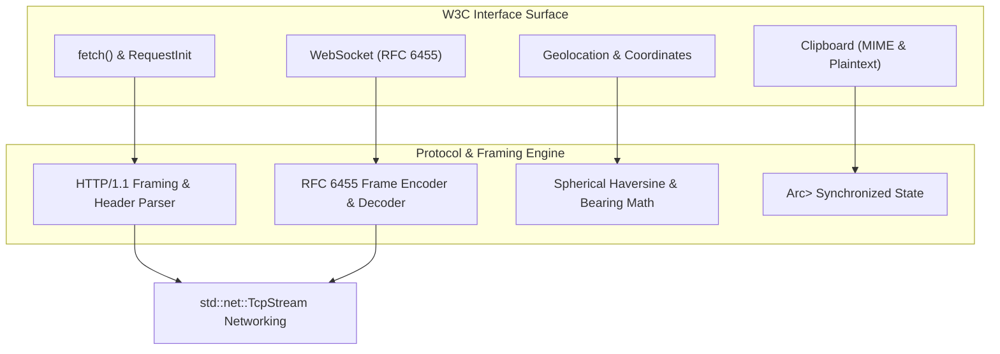
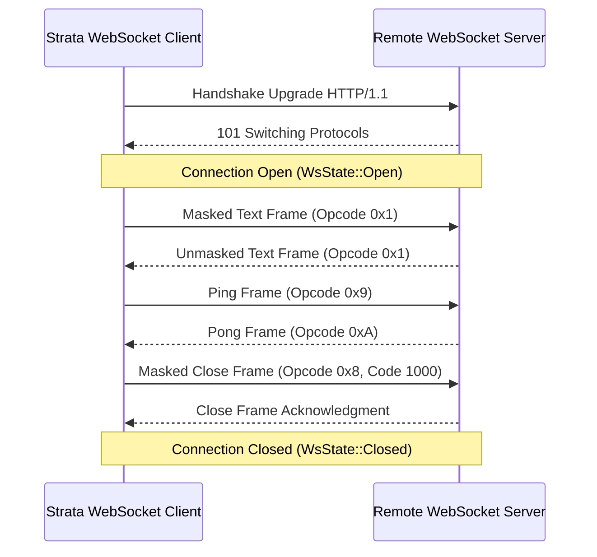

# strata_web_api

Zero-Dependency W3C Web Platform APIs in Pure Idiomatic Rust.

The `strata_web_api` crate provides standard-compliant implementations of core W3C Web Platform APIs, including `fetch()`, `WebSocket` (RFC 6455), `Geolocation`, and `Clipboard`. Written in pure standard-library Rust without external dependencies or C bindings, it delivers seamless parity between Web standards and native operating system environments.

---

## Architecture Overview

Modern web applications rely heavily on standard browser interfaces for asynchronous networking, streaming communication, spatial awareness, and system clipboard interoperability. When porting or executing web architectures natively, developers are often forced to choose between heavyweight native wrappers (such as `reqwest` + `tokio` + OpenSSL/rustls) or disparate platform-specific SDKs.

`strata_web_api` adopts a zero-dependency architecture:
- **Zero Heavy C-FFI Dependencies**: Eliminates libcurl, OpenSSL, or Chromium networking layers.
- **W3C Standard Compliance**: Case-insensitive HTTP headers, standard status code predicates (`response.ok()`), AbortController signals, and RFC 6455 WebSocket framing.
- **Deterministic Pure Rust Primitives**: High-precision spherical coordinate mathematics (Haversine formula and forward bearing) implemented without external geometry libraries.



---

## The `fetch()` Engine

The `fetch()` function executes HTTP requests using standard-library TCP sockets while adhering to the W3C Fetch specification.

```rust
use strata_web_api::prelude::*;

fn query_service() -> Result<(), FetchError> {
    let req = RequestInit::post()
        .header("Content-Type", "application/json")
        .header("Accept", "application/json")
        .body_json_str(r#"{"query": "cluster_metrics", "limit": 10}"#);

    let response = fetch("http://api.internal.network:8080/v1/query", Some(req))?;

    if response.ok() {
        let body_text = response.text()?;
        println!("Response payload: {body_text}");
    } else {
        eprintln!("HTTP Error: {} {}", response.status, response.status_text);
    }

    Ok(())
}
```

### Request Configuration (`RequestInit`)

`RequestInit` provides a fluent builder API for constructing HTTP requests:

```rust
#[derive(Clone)]
pub struct RequestInit {
    pub method: String,
    pub headers: Headers,
    pub body: Option<Vec<u8>>,
    pub timeout_ms: Option<u64>,
    pub signal: Option<AbortSignal>,
}
```

#### Builder Methods
- `RequestInit::get()` / `RequestInit::post()` / `RequestInit::put()` / `RequestInit::delete()`
- `.header(key, val)`: Injects or updates a header.
- `.body(bytes)`: Attaches raw byte payload.
- `.body_json_str(json_str)`: Automatically sets `Content-Type: application/json` and attaches body bytes.
- `.signal(signal)`: Binds an `AbortSignal` for cooperative request cancellation.

---

### Case-Insensitive Headers (`Headers`)

In compliance with RFC 7230, HTTP header names are case-insensitive. The `Headers` struct normalizes all lookup keys:

```rust
use strata_web_api::fetch::Headers;

let mut headers = Headers::new();
headers.set("Authorization", "Bearer token_abc123");
headers.set("content-type", "application/json");

// Case-insensitive lookup
assert_eq!(headers.get("AUTHORIZATION"), Some("Bearer token_abc123"));
assert_eq!(headers.get("Content-Type"), Some("application/json"));
assert!(headers.has("content-TYPE"));

// Deletion
headers.delete("authorization");
assert!(!headers.has("Authorization"));
```

---

### Request Cancellation (`AbortController` & `AbortSignal`)

`AbortController` allows cancellation of in-flight network requests across thread boundaries:

```rust
use strata_web_api::prelude::*;
use std::sync::Arc;
use std::thread;

let controller = Arc::new(AbortController::new());
let signal = controller.signal();

// Spawn cancellation timer
let controller_clone = Arc::clone(&controller);
thread::spawn(move || {
    std::thread::sleep(std::time::Duration::from_millis(50));
    controller_clone.abort();
});

let req = RequestInit::get().signal(signal);
match fetch("http://slow.service.network:8080/data", Some(req)) {
    Err(FetchError::Aborted) => println!("Request cancelled successfully via AbortController."),
    Ok(res) => println!("Request completed before abort: {}", res.status),
    Err(e) => eprintln!("Network error: {e}"),
}
```

---

### Multipart Form Data (`FormData`)

The `FormData` abstraction constructs standard `multipart/form-data` payloads with custom boundaries:

```rust
use strata_web_api::fetch::FormData;

let mut form = FormData::new();
form.append("username", "admin");
form.append("upload_id", "up_9021");

let boundary = "----StrataBoundary7MA4YWxkTrZu0gW";
let payload: Vec<u8> = form.to_multipart_payload(boundary);
```

---

## RFC 6455 WebSocket Engine

The `strata_web_api::websocket` module provides complete byte-level serialization, frame decoding, and connection state management adhering to RFC 6455.



### Opcodes and Framing

```rust
#[derive(Debug, Clone, Copy, PartialEq, Eq)]
pub enum WsOpcode {
    Continuation = 0x0,
    Text = 0x1,
    Binary = 0x2,
    Close = 0x8,
    Ping = 0x9,
    Pong = 0xA,
}

#[derive(Debug, Clone, Copy, PartialEq, Eq)]
pub enum WsState {
    Connecting = 0,
    Open = 1,
    Closing = 2,
    Closed = 3,
}
```

### Frame Encoding and Decoding

Frames sent by a client to a server must be masked with a 4-byte XOR key.

```rust
use strata_web_api::websocket::{encode_frame, decode_frame, WsOpcode, WsFrame};

// Encode a masked text frame
let payload = b"Hello, Strata";
let mask_key = Some([0x1A, 0x2B, 0x3C, 0x4D]);
let encoded_bytes = encode_frame(true, WsOpcode::Text, payload, true, mask_key);

// Decode raw incoming buffer
if let Ok(Some((frame, bytes_consumed))) = decode_frame(&encoded_bytes) {
    assert_eq!(frame.opcode, WsOpcode::Text);
    assert_eq!(frame.payload, payload);
    assert_eq!(bytes_consumed, encoded_bytes.len());
}
```

### High-Level `WebSocket` Client

```rust
use strata_web_api::prelude::*;

let ws = WebSocket::new("ws://telemetry.internal.network:9001");
ws.set_open();

// Queue outgoing messages
ws.send_text("SUBSCRIBE telemetry_channel_1")?;
ws.send_ping(b"heartbeat")?;

// Drain raw frame buffers for TCP transmission
let outgoing_frames: Vec<Vec<u8>> = ws.drain_outgoing_frames();

// Ingest received bytes from TCP socket
let incoming_socket_bytes: &[u8] = &[/* raw received bytes */];
ws.ingest_incoming_bytes(incoming_socket_bytes)?;

// Poll decoded messages
while let Some(msg) = ws.poll_message() {
    match msg {
        WsMessage::Text(text) => println!("Received text: {text}"),
        WsMessage::Binary(bin) => println!("Received binary: {} bytes", bin.len()),
        WsMessage::Ping(data) => println!("Received Ping"),
        WsMessage::Pong(data) => println!("Received Pong"),
        WsMessage::Close(code, reason) => println!("Closed: {:?} {reason}", code),
    }
}

// Graceful closure
ws.close(1000, "Normal Closure")?;
```

---

## W3C Geolocation API

The `Geolocation` module implements W3C Geolocation standards alongside great-circle coordinate mathematics.

```rust
use strata_web_api::prelude::*;

let geo = Geolocation::new();

// Set simulated coordinate (e.g. Zurich: 47.3769 N, 8.5417 E)
geo.set_mock_position(GeoCoordinates::new(47.3769, 8.5417, 5.0));

let position: GeolocationPosition = geo.get_current_position()?;
println!("Latitude: {:.4}, Longitude: {:.4}", position.coords.latitude, position.coords.longitude);
println!("Accuracy: {:.1} meters, Timestamp: {}", position.coords.accuracy, position.timestamp);
```

### Great-Circle Mathematics (Haversine & Azimuth)

The crate provides zero-dependency implementations of standard geodetic formulas operating on WGS84 coordinates:

```rust
use strata_web_api::geolocation::{haversine_distance_meters, initial_bearing_degrees};

// Zurich (47.3769, 8.5417) to London (51.5074, -0.1278)
let lat1 = 47.3769;
let lon1 = 8.5417;
let lat2 = 51.5074;
let lon2 = -0.1278;

// Haversine distance in meters
let distance_m = haversine_distance_meters(lat1, lon1, lat2, lon2);
println!("Distance: {:.2} km", distance_m / 1000.0); // ~778.6 km

// Forward azimuth (bearing) in degrees [0, 360)
let bearing_deg = initial_bearing_degrees(lat1, lon1, lat2, lon2);
println!("Initial bearing: {:.1} degrees", bearing_deg);
```

---

## W3C Clipboard API

The `Clipboard` module provides synchronized access to system clipboard buffers:

```rust
use strata_web_api::prelude::*;

let clipboard = Clipboard::new();

// Plaintext read and write
clipboard.write_text("Strata High-Performance Runtime")?;
let text = clipboard.read_text()?;
assert_eq!(text, "Strata High-Performance Runtime");

// MIME-typed arbitrary binary data
let png_bytes = b"\x89PNG\r\n\x1a\n...";
clipboard.write_data("image/png", png_bytes)?;

if let Some(retrieved_png) = clipboard.read_data("image/png")? {
    assert_eq!(retrieved_png, png_bytes);
}

// Clear clipboard
clipboard.clear()?;
```

---

## Error Handling Specifications

| Type | Variant | Description |
| :--- | :--- | :--- |
| `FetchError` | `InvalidUrl(String)` | Malformed URL or unsupported URI scheme. |
| | `NetworkError(String)` | Connection refused, reset, or broken pipe. |
| | `Timeout(String)` | Network socket timed out prior to response. |
| | `Aborted` | In-flight request was terminated via `AbortSignal`. |
| | `SerializationError(String)` | Response body failed UTF-8 or JSON deserialization. |
| `WsError` | `InvalidState(String)` | Attempted write or close while connection is not open. |
| | `ProtocolError(String)` | Invalid frame structure or malformed UTF-8 payload. |
| | `InvalidFrame(String)` | Unknown opcode or corrupt payload length encoding. |
| | `Closed` | Socket connection has already transitioned to closed. |
| `GeolocationError` | `PermissionDenied(String)` | Location services authorization declined by user or OS. |
| | `PositionUnavailable(String)` | Hardware GPS / network triangulation unavailable. |
| | `Timeout(String)` | Fix acquisition timed out. |
| `ClipboardError` | `Unavailable(String)` | System display server / clipboard daemon unavailable. |
| | `PermissionDenied(String)` | Clipboard read/write denied by OS sandbox policies. |
| | `InvalidData(String)` | Payload exceeds buffer limits or contains corrupt data. |
