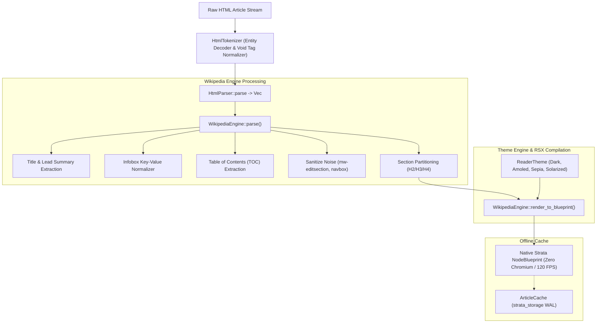
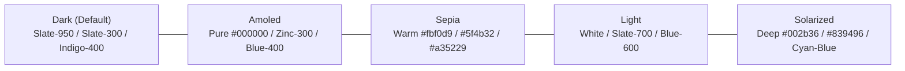

# strata_web_reader

Semantic HTML5 Stream Tokenizer, Reader Theme Engine, and Offline Wikipedia Reader.

The `strata_web_reader` crate provides a lightweight, zero-Chromium semantic web transpiler and reader engine for Strata. It converts raw HTML5 article streams into native Strata component trees (`NodeBlueprint`), applying distraction-free typographic themes (Dark, Amoled, Sepia) and extracting structured Wikipedia metadata (Infoboxes, Table of Contents, Lead Summaries) with zero JavaScript execution overhead.

---

## Architecture Overview

Rendering modern web articles through conventional browser engines incurs immense resource waste:
- **Chromium / WebKit Bloat**: Spawning web view processes consumes 150MB+ of baseline RAM per article.
- **JavaScript Execution Hazards**: Untrusted scripts execute trackers, ad injectors, and layout-blocking bundles.
- **Visual Clutter**: Cluttered navigation headers, popups, and sidebars distract from reading content.

`strata_web_reader` treats web documents as pure semantic data pipelines:
1. **HTML5 Stream Tokenizer**: Emits structured tokens from raw byte streams, resolving named and numeric entities without external dependencies.
2. **Semantic DOM Parser**: Constructs a clean, lightweight AST (`SemanticNode`) that preserves headings, lists, tables, code blocks, and media while stripping scripts and ads.
3. **Typographic Theme Engine**: Restructures content into beautiful typography calibrated for legibility across Dark, Amoled, Sepia, and Solarized palettes.
4. **Offline Bitcask Storage Integration**: Caches raw articles and parsed models locally using `strata_storage` WAL for instant offline access.



---

## HTML5 Stream Tokenizer (`HtmlTokenizer`)

The tokenizer processes raw HTML streams without allocating full intermediate strings:

```rust
use strata_web_reader::prelude::*;

let html = r#"<article class="prose"><h1 id="intro">Telemetry &amp; Cloud</h1></article>"#;
let mut tokenizer = HtmlTokenizer::new(html);

while let Some(token) = tokenizer.next_token() {
    match token {
        HtmlToken::StartTag { name, attributes, self_closing } => {
            println!("Start tag: <{name}> (self_closing: {self_closing})");
        }
        HtmlToken::Text(text) => {
            println!("Decoded text: {text}"); // Automatically resolves &amp; to &
        }
        HtmlToken::EndTag { name } => {
            println!("End tag: </{name}>");
        }
        _ => {}
    }
}
```

### Character Entity Decoding (`decode_html_entities`)

Resolves named HTML entities and numeric decimal/hexadecimal references in a single pass:

| Entity Input | Decoded Representation | Character Class |
| :--- | :--- | :--- |
| `&amp;` | `&` | Core XML/HTML delimiter |
| `&lt;` / `&gt;` | `<` / `>` | Bracket delimiters |
| `&quot;` / `&apos;` | `"` / `'` | Quote marks |
| `&nbsp;` | `\u{00A0}` | Non-breaking space |
| `&mdash;` / `&ndash;` | `—` / `–` | Em dash / En dash |
| `&#160;` | `\u{00A0}` | Decimal character reference |
| `&#x2014;` | `—` | Hexadecimal character reference |

---

## Semantic DOM AST (`SemanticNode`)

The `SemanticNode` enum represents a simplified document object model:

```rust
#[derive(Debug, Clone, PartialEq)]
pub enum SemanticNode {
    /// HTML Element with attributes and nested children.
    Element {
        tag: String,
        attributes: Vec<(String, String)>,
        children: Vec<SemanticNode>,
    },
    /// Plaintext leaf node with decoded character entities.
    Text(String),
    /// HTML comments.
    Comment(String),
}
```

### Traversal and Query Helpers

`SemanticNode` provides query utilities modeled after web APIs:
- `.attr("href")`: Case-insensitive attribute lookup.
- `.has_class("infobox")`: Boolean CSS class presence check.
- `.classes()`: Tokenized vector of class names.
- `.text_content()`: Recursively collects all nested text bytes into a clean string.
- `.find_first(tag)` / `.find_all(tag)`: Recursive descendant search by tag name.
- `.find_by_class(class)`: Searches subtrees for elements matching a CSS class.

---

## Typographic Theme Engine (`ReaderTheme`)

`ReaderTheme` manages visual appearance, color contrast, and typographic width:

```rust
#[derive(Debug, Clone, PartialEq)]
pub struct ReaderTheme {
    pub name: String,
    pub bg_class: String,
    pub text_class: String,
    pub heading_class: String,
    pub link_class: String,
    pub border_class: String,
    pub card_bg_class: String,
    pub code_bg_class: String,
    pub font_size_scale: f32,
    pub max_width_px: u32,
}
```

### Aesthetic Presets



- **`ReaderTheme::dark()` (Default)**: Optimized for modern developer environments (`bg-slate-950`, `text-slate-300`, `text-indigo-400` links).
- **`ReaderTheme::amoled()`**: Pure pitch-black (`#000000`) background designed to maximize battery efficiency on OLED displays by turning off pixels.
- **`ReaderTheme::sepia()`**: Warm low-contrast cream palette (`#fbf0d9` background, `#5f4b32` text) that reduces eye strain during long-form reading sessions.
- **`ReaderTheme::light()`**: Crisp paper white aesthetic for high-illumination environments.
- **`ReaderTheme::solarized()`**: Classic Ethan Schoonover palette (`#002b36` background) with cyan and blue accents.

---

## Dedicated Wikipedia Article Engine (`WikipediaEngine`)

The `WikipediaEngine` normalizes Wikipedia HTML markup into structured models:

```rust
use strata_web_reader::prelude::*;

let raw_html = /* Fetched Wikipedia HTML document */;
let article: WikipediaArticle = WikipediaEngine::parse(raw_html);

println!("Title: {}", article.title);
println!("Summary: {}", article.summary);

if let Some(infobox) = &article.infobox {
    println!("Infobox: {}", infobox.title);
    for row in &infobox.rows {
        println!("  {}: {}", row.label, row.value);
    }
}

for item in &article.toc {
    println!("Section {}: {} (#{})", item.number, item.title, item.anchor);
}
```

### Data Models

```rust
pub struct WikipediaArticle {
    pub title: String,
    pub summary: String,
    pub infobox: Option<WikipediaInfobox>,
    pub toc: Vec<WikipediaTocItem>,
    pub sections: Vec<WikipediaSection>,
}

pub struct WikipediaInfobox {
    pub title: String,
    pub image_url: Option<String>,
    pub image_caption: Option<String>,
    pub rows: Vec<InfoboxRow>,
}

pub struct InfoboxRow {
    pub label: String,
    pub value: String,
}

pub struct WikipediaTocItem {
    pub level: usize,
    pub number: String,
    pub title: String,
    pub anchor: String,
}

pub struct WikipediaSection {
    pub title: Option<String>,
    pub level: usize,
    pub nodes: Vec<SemanticNode>,
}
```

### Content Sanitization

Before building the layout, the engine strips Wikipedia-specific interface noise:
- Removes `.mw-editsection` ("edit") links.
- Strips bottom `.navbox` multi-link matrices and categories.
- Eradicates `.mw-empty-elt` tracking pixels and metadata wrappers.
- Strips all `<script>` and `<style>` blocks.

### Native UI Compilation (`render_to_blueprint`)

Converts a `WikipediaArticle` into a native Strata `NodeBlueprint` layout tree:

```rust
use strata_web_reader::prelude::*;
use strata_dom::NodeBlueprint;

let theme = ReaderTheme::dark();
let blueprint: NodeBlueprint = WikipediaEngine::render_to_blueprint(&article, &theme);
```

The resulting component tree includes:
1. **Header Badge**: Displays uppercase tracking metadata and bold article title.
2. **Modern Infobox Card**: Formats key-value pairs, lead images, and captions into a clean sidebar card.
3. **Table of Contents (TOC) Card**: Provides section jumping links.
4. **Body Sections**: Renders typography-scaled prose with responsive column margins.

---

## Offline Article Cache (`ArticleCache`)

The `ArticleCache` integrates with `strata_storage`'s Bitcask WAL to deliver persistent, offline-first reading:

```rust
use strata_web_reader::prelude::*;

// Open article cache backed by standard app_data WAL
let cache = ArticleCache::default_instance();

// Store article for offline reading
let slug = "Distributed_Systems";
cache.store(slug, raw_html_content);

// Check offline availability
if cache.contains(slug) {
    let cached_html = cache.fetch(slug).expect("Article is cached");
    let article = WikipediaEngine::parse(&cached_html);
    println!("Loaded offline: {}", article.title);
}

// List all offline articles
let stored_slugs: Vec<String> = cache.cached_articles();
for slug in stored_slugs {
    println!("Available offline: {slug}");
}

// Remove from cache
cache.remove(slug);
```
