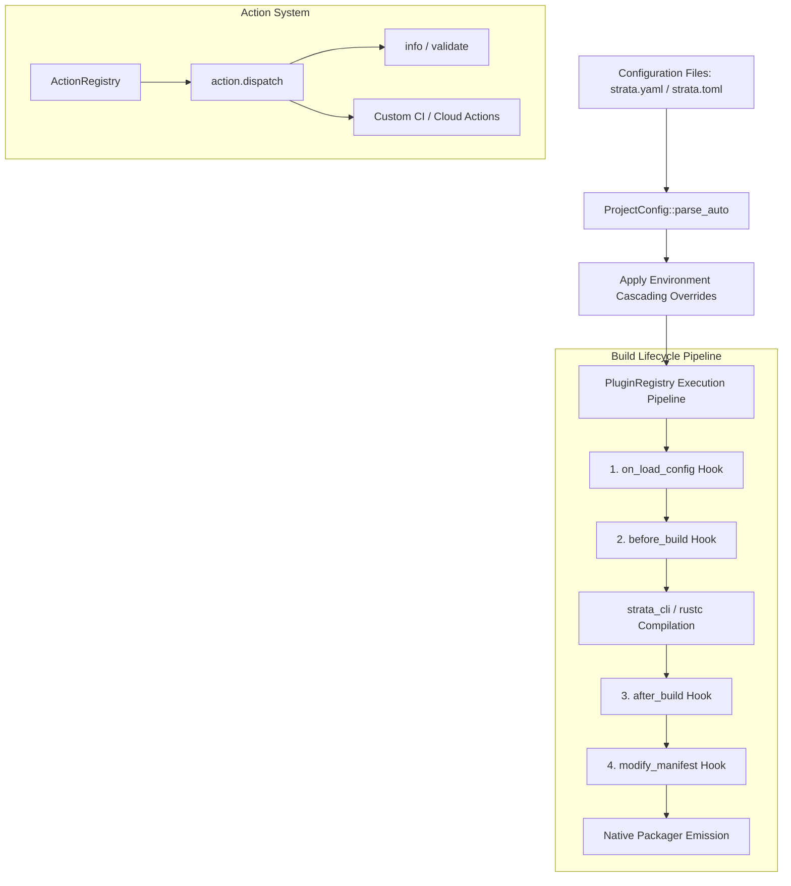

# strata-build

The `strata_build` crate implements the build pipeline orchestration engine, dynamic build plugin framework, multi-format configuration parser (`strata.toml`, `strata.yaml`), environment-dependent cascading override system, and custom lifecycle action execution engine for Project Strata applications.

---

## Architectural Topology

The build engine provides compile-time and packaging-time hooks allowing developers to mutate configurations, run code generation tasks, audit security parameters, and alter target manifests across varied infrastructure deployment environments:



---

## Subsystem Reference

The crate is structured into four core modules:

| Module | Core Structs / Types | Functional Purpose |
| :--- | :--- | :--- |
| `config` | `ProjectConfig`, `AppConfig`, `WindowConfig`, `WebConfig`, `BuildConfig` | Strongly-typed configuration model with dual-format TOML/YAML deserialization and environmental overrides. |
| `plugin` | `BuildPlugin`, `PluginRegistry`, `BuildContext`, `BuildArtifacts`, `PackageManifest`, `DynamicBrandingPlugin` | Trait definition and runner for dynamic build plugins intercepting compilation and packaging lifecycles. |
| `action` | `ActionRegistry`, `ActionContext`, `ActionHandler` | Extensible task dispatcher executing named lifecycle hooks and custom automation scripts. |
| `yaml_parser` | `parse_yaml`, `YamlValue` | Lightweight zero-dependency YAML tokenizer and parser mapping key-value maps and arrays. |

---

## Configuration Architecture

Strata projects support declarative configuration using either YAML (`strata.yaml` / `strata.yml`) or TOML (`strata.toml`).

### Configuration Resolution Precedence

When loading project configuration from a directory, the engine evaluates file existence in descending priority order:
1. `strata.yaml` (highest precedence)
2. `strata.yml`
3. `strata.toml`
4. Built-in defaults (`ProjectConfig::default()`)

### Complete `strata.yaml` Specification

```yaml
app:
  name: cloud-telemetry-portal
  version: 2.1.0
  template: saas
  description: Distributed Cloud Infrastructure Monitoring and Telemetry Hub

window:
  title: Cloud Infrastructure Telemetry Portal
  width: 1600
  height: 960
  resizable: true
  fullscreen: false

web:
  target: web-js
  output_dir: dist/web

build:
  target_cpu: native
  opt_level: "3"
  plugins:
    - dynamic-branding
    - telemetry-audit

env_overrides:
  production:
    app_name: cloud-telemetry-portal-prod
    window_title: Cloud Infrastructure Portal [PRODUCTION]
  staging:
    app_name: cloud-telemetry-portal-stage
    window_title: Cloud Infrastructure Portal [STAGING]
  ci:
    opt_level: "1"
```

### Dual-Format Parser API

`ProjectConfig::parse_auto` intelligently parses configuration based on file extension or format hints:

```rust
use strata_build::config::ProjectConfig;

// Parse directly from YAML content
let yaml_source = r#"
app:
  name: cloud-metrics-agent
  version: 1.0.0
window:
  width: 1280
  height: 720
"#;

let config = ProjectConfig::parse_auto(yaml_source, true).expect("Valid YAML configuration");
assert_eq!(config.app.name, "cloud-metrics-agent");
assert_eq!(config.window.width, 1280);
```

---

## Dynamic Build Plugin Framework

The `BuildPlugin` trait provides five standardized lifecycle interception points:

```rust
use std::path::PathBuf;
use strata_build::config::ProjectConfig;

pub struct BuildContext {
    pub target: String,
    pub environment: String,
    pub out_dir: PathBuf,
    pub release: bool,
}

pub struct BuildArtifacts {
    pub binary_path: Option<PathBuf>,
    pub output_files: Vec<PathBuf>,
    pub total_size_bytes: u64,
}

pub struct PackageManifest {
    pub app_name: String,
    pub version: String,
    pub identifier: String,
    pub executable_name: String,
}

pub trait BuildPlugin: Send + Sync {
    /// Unique identifier for the plugin.
    fn name(&self) -> &str;

    /// Invoked immediately after configuration is loaded and before compilation begins.
    fn on_load_config(&self, _config: &mut ProjectConfig, _env: &str) -> Result<(), String> {
        Ok(())
    }

    /// Invoked right before the compiler / bundler starts.
    fn before_build(&self, _context: &BuildContext) -> Result<(), String> {
        Ok(())
    }

    /// Invoked immediately after compilation finishes.
    fn after_build(&self, _artifacts: &BuildArtifacts) -> Result<(), String> {
        Ok(())
    }

    /// Invoked before native packaging to adjust installer/distro metadata.
    fn modify_manifest(&self, _manifest: &mut PackageManifest) -> Result<(), String> {
        Ok(())
    }
}
```

### Implementing a Custom Plugin

Here is an enterprise branding and cloud telemetry injection plugin:

```rust
use strata_build::plugin::{BuildPlugin, BuildContext, BuildArtifacts, PackageManifest};
use strata_build::config::ProjectConfig;

pub struct CloudDeploymentPlugin {
    pub cluster_region: String,
}

impl BuildPlugin for CloudDeploymentPlugin {
    fn name(&self) -> &str {
        "cloud-deployment"
    }

    fn on_load_config(&self, config: &mut ProjectConfig, env: &str) -> Result<(), String> {
        if env == "production" {
            config.window.title = format!("{} [Region: {}]", config.window.title, self.cluster_region);
        }
        Ok(())
    }

    fn before_build(&self, context: &BuildContext) -> Result<(), String> {
        println!("Compiling cloud frontend for target {} in environment {}", context.target, context.environment);
        Ok(())
    }

    fn modify_manifest(&self, manifest: &mut PackageManifest) -> Result<(), String> {
        manifest.identifier = format!("com.infrastructure.telemetry.{}", manifest.app_name);
        Ok(())
    }
}
```

### Plugin Registry Orchestration

The `PluginRegistry` executes registered plugins sequentially, short-circuiting execution if any plugin returns an error:

```rust
use strata_build::plugin::{PluginRegistry, DynamicBrandingPlugin};
use strata_build::config::ProjectConfig;

let mut registry = PluginRegistry::new();

// Register dynamic branding plugin
registry.register(Box::new(DynamicBrandingPlugin::new("acme-", "-service")));

let mut config = ProjectConfig::default();
config.app.name = "telemetry".to_string();

// Execute configuration load hook
registry.execute_on_load_config(&mut config, "production").unwrap();

assert_eq!(config.app.name, "acme-telemetry-service");
assert_eq!(config.window.title, "acme-telemetry-service (PROD)");
```

---

## Action Execution Subsystem

The `action` module enables registering and dispatching custom automation scripts and deployment tasks:

```rust
use strata_build::action::{ActionRegistry, ActionContext};
use strata_build::config::ProjectConfig;

let mut registry = ActionRegistry::new();

// Built-in 'validate' and 'info' actions are pre-registered
let ctx = ActionContext {
    name: "validate".to_string(),
    environment: "production".to_string(),
    arguments: vec![],
    config: ProjectConfig::default(),
};

let status = registry.dispatch(&ctx).expect("Validation succeeds");
assert_eq!(status, "Project configuration is valid");

// Register a custom cloud telemetry deployment action
registry.register("deploy-edge", |ctx| {
    println!("Deploying binary for {} to edge CDN nodes", ctx.config.app.name);
    Ok("Edge deployment complete".to_string())
});
```

---

## Zero-Dependency YAML Parser

`strata_build::yaml_parser` provides a compact recursive-descent YAML parser without third-party dependencies:

```rust
use strata_build::yaml_parser::{parse_yaml, YamlValue};

let yaml = r#"
app:
  name: cloud-monitor
  tags:
    - infrastructure
    - telemetry
"#;

let parsed = parse_yaml(yaml).expect("Valid YAML");
assert_eq!(parsed["app"]["name"].as_str(), Some("cloud-monitor"));
assert_eq!(parsed["app"]["tags"][0].as_str(), Some("infrastructure"));
```
