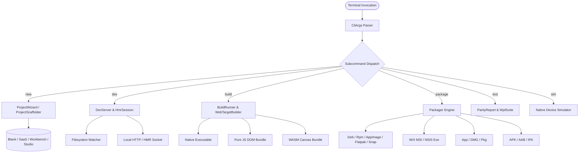
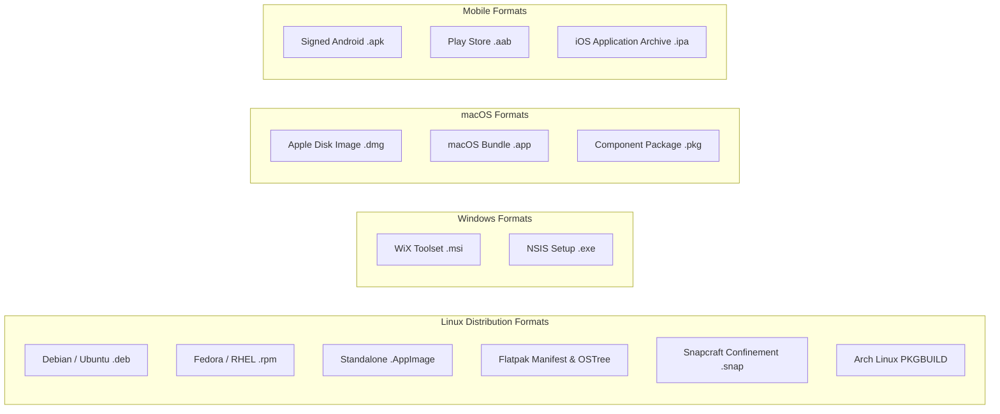

# strata-cli

The `strata_cli` crate delivers the universal developer toolchain and command-line orchestrator for Project Strata. It provides high-performance project scaffolding, a sub-3ms state-preserving Hot Module Replacement (HMR) development server, multi-target compilation runners, native operating system installer packaging, automated Chromium WPT layout parity testing, and native mobile device simulation.

---

## Architectural Topology

The CLI is engineered with a modular, zero-dependency design. Command parsing, interactive terminal prompts, compilation drivers, and release packaging run directly on native Rust primitives without pulling large runtime runtimes or external script engines.



---

## Core Components and Modules

The crate is structured into dedicated operational subsystems:

| Module | Core Structs / Types | Functional Purpose |
| :--- | :--- | :--- |
| `args` | `CliArgs`, `CliCommand`, `BuildTarget`, `PackageFormat`, `TemplateKind` | Zero-dependency CLI argument tokenizer, flag validation, and help text formatting. |
| `scaffold` | `ProjectScaffolder`, `ScaffoldReport` | Workspace directory creation, Cargo manifest generation, template source rendering, and `.gitignore` setup. |
| `wizard` | `ProjectWizard`, `WizardConfig` | Interactive terminal UI wizard utilizing raw-mode keyboard listeners and ANSI VT100 control sequences. |
| `prompt` | `TextPrompt`, `SelectPrompt`, `MultiSelectPrompt`, `Terminal` | Reusable terminal prompt primitives supporting Vim navigation keys (`j`/`k`), spacebar toggles, and input validation. |
| `dev_server` | `DevServer`, `DevServerConfig`, `HmrSession` | Persistent development server with non-blocking TCP socket, live AST hot-patching, and terminal keyboard commands. |
| `builder` | `BuildRunner`, `BuildReport` | Cross-compilation driver orchestrating native binary linking, Web JS DOM generation, and WASM canvas bundle output. |
| `packager` | `Packager`, `PackageReport` | Multi-format installer generator emitting native distribution packages for Linux, Windows, macOS, Android, and iOS. |
| `config` | `StrataConfig`, `AppConfig`, `WindowConfigSection`, `WebConfigSection` | Unified configuration loader parsing `strata.yaml`, `strata.yml`, and `strata.toml` with environment overrides. |
| `plugin` | `PluginEngine`, `PluginContext`, `StrataBuildPlugin` | Build and packaging lifecycle interception engine allowing custom Rust plugins to transform configs and artifacts. |
| `parity` | `ParityReport`, `ParityTestCase` | W3C Web Platform Test (WPT) visual parity verification harness evaluating layout metrics against Chromium. |

---

## Global Invocations and Argument Grammar

The Strata CLI follows standard POSIX argument grammar and provides contextual subcommands:

```bash
strata <COMMAND> [OPTIONS]
```

### Global Flags

- `-h, --help`: Displays contextual usage documentation for the root executable or any specified subcommand.
- `-v, --version`: Prints the current toolchain release version and target architecture.

---

## Subcommand Reference

### 1. `strata new`

Creates a new Strata application workspace. When invoked without arguments, it launches the interactive terminal setup wizard.

```bash
strata new [NAME] [OPTIONS]
```

#### Arguments and Options

| Parameter | Type | Default | Description |
| :--- | :--- | :--- | :--- |
| `[NAME]` | Positional String | `None` | Name of the project directory and package. If omitted, prompts the user interactively. |
| `-t, --template <TEMPLATE>` | Flag String | `blank` | Template identifier: `blank`, `saas`, `workbench`, `studio`, `ecommerce`. |
| `-d, --dir <PATH>` | PathBuf | `.` | Destination parent directory where the project directory will be created. |
| `-h, --help` | Flag | `false` | Prints command-specific help information. |

#### Interactive Setup Wizard

The interactive wizard configures the application environment through three sequential steps:
1. **Project Name Prompt**: Validates character constraints (`[a-zA-Z0-9_-]`) and checks that the destination directory does not already exist with conflicting contents.
2. **Template Selection**: Allows navigation using arrow keys (`Up`/`Down`) or Vim keys (`k`/`j`), displaying descriptions for each template.
3. **Target Platform Multi-Select**: Allows toggling target compilation platforms (`Desktop`, `Web`, `Mobile`, `Universal`) using the `Space` key.

#### Programmatic Scaffolding Example

```bash
# Scaffold a cloud infrastructure telemetry dashboard
strata new telemetry-portal --template saas --dir /var/projects/services
```

Generated project structure:
```text
telemetry-portal/
├── Cargo.toml
├── strata.toml
├── README.md
├── .gitignore
└── src/
    └── main.rs
```

---

### 2. `strata dev`

Launches the local development runtime with file-watching, state-preserving signal Hot Module Replacement, and direct hardware swapchain presentation.

```bash
strata dev [OPTIONS]
```

#### Options

| Parameter | Type | Default | Description |
| :--- | :--- | :--- | :--- |
| `-t, --target <TARGET>` | Enum | `desktop` | Execution backend: `desktop`, `android`, `ios`, `macos`, `windows`, `linux`, `web-wasm`, `web-js`. |
| `-p, --port <PORT>` | Integer (`u16`) | `3000` | Local HTTP server and HMR IPC port. |
| `--no-watch` | Flag | `false` | Disables the background filesystem change watcher. |
| `-h, --help` | Flag | `false` | Prints command-specific help information. |

#### Interactive Terminal Hotkeys

While `strata dev` is running, the terminal stdin listener accepts real-time single-key controls:

- `r`: Triggers an immediate manual HMR state synchronization and hot-patch reload.
- `c`: Clears the terminal screen buffer and re-prints connection endpoints.
- `h`: Displays the available interactive command menu.
- `q`: Gracefully terminates the dev server process, shutting down the background HTTP listener.

#### Invocation Example

```bash
# Launch development server for web JavaScript target on port 8080
strata dev --target web-js --port 8080
```

---

### 3. `strata build`

Compiles optimized binaries, JavaScript ECMAScript modules, or WebAssembly artifacts for targeted execution platforms.

```bash
strata build [OPTIONS]
```

#### Options

| Parameter | Type | Default | Description |
| :--- | :--- | :--- | :--- |
| `-t, --target <TARGET>` | Enum | `desktop` | Target platform: `desktop`, `android`, `ios`, `macos`, `windows`, `linux`, `web-wasm`, `web-js`. |
| `-r, --release` | Flag | `false` | Enables full Link-Time Optimization (LTO) and binary symbol stripping. |
| `-e, --env <ENV>` | String | `development` | Active environment profile (e.g. `production`, `staging`, `ci`). |
| `-o, --out-dir <DIR>` | PathBuf | `.` | Root directory containing the project or custom output destination. |
| `-h, --help` | Flag | `false` | Prints command-specific help information. |

#### Build Artifact Generation Matrix

- **Web JS (`--target web-js`)**: Invokes `strata_codegen_js` to generate a zero-WASM pure JavaScript bundle:
  - `dist/web-js/index.html`: Entrypoint HTML hosting DOM mount containers.
  - `dist/web-js/app.js`: Transpiled reactive UI tree and DOM manipulation logic.
  - `dist/web-js/runtime.js`: Pure JavaScript reactive signal runtime.
  - `dist/web-js/styles.css`: JIT-generated atomic Tailwind utility stylesheets.
- **Web WASM (`--target web-wasm`)**: Emits WebAssembly canvas bindings and high-performance WebGL2/WebGPU loader wrappers:
  - `dist/web-wasm/index.html`: WebGPU canvas host page.
  - `dist/web-wasm/strata_loader.js`: Asynchronous WASM binary streaming loader.
- **Native Targets (`desktop`, `linux`, `windows`, `macos`)**: Emits stripped native binaries and a metadata manifest (`dist/<target>/strata_build.json`).

---

### 4. `strata package`

Packages compiled application binaries into signed installers, platform application bundles, and containerized distribution formats.

```bash
strata package [OPTIONS]
```

#### Options

| Parameter | Type | Default | Description |
| :--- | :--- | :--- | :--- |
| `-t, --target <TARGET>` | Enum | `desktop` | Target platform architecture. |
| `-f, --format <FORMAT>` | Enum | Target Default | Explicit package format override. |
| `-e, --env <ENV>` | String | `production` | Environment configuration profile. |
| `-o, --out-dir <DIR>` | PathBuf | `.` | Project root directory where `dist/packages/` will be generated. |
| `-h, --help` | Flag | `false` | Prints command-specific help information. |

#### Supported Packaging Formats



#### Linux Packaging Implementation Details

1. **Debian (`.deb`)**:
   Generates a compliant binary package structure:
   - `DEBIAN/control`: Specifies package name, version, architecture (`amd64`), and maintainer metadata.
   - `usr/bin/<app_name>`: Installed binary location.
   - `usr/share/applications/<app_name>.desktop`: XDG desktop entry specification.
2. **Red Hat (`.rpm`)**:
   Generates a complete RPM build specification (`<app_name>.spec`) containing `%install`, `%files`, and description directives alongside the binary payload.
3. **AppImage (`.AppImage`)**:
   Assembles an execution-ready `AppDir` containing:
   - `AppRun`: Shell bootstrap script calculating relative `$HERE` paths and dispatching to `usr/bin/<app_name>`.
   - `<app_name>.desktop`: Standard Freedesktop application entrypoint.
4. **Flatpak (`dev.strata.<app_name>.json`)**:
   Generates an OSTree manifest targeting the `org.freedesktop.Platform` 23.08 runtime, requesting necessary Wayland, X11 fallback, and DRI GPU acceleration sockets.
5. **Snapcraft (`snap/snapcraft.yaml`)**:
   Constructs a `core22` snap specification configured with `strict` confinement and required plugs (`x11`, `wayland`, `opengl`, `network`).

#### Windows Packaging Details

- **WiX Toolset (`Product.wxs`)**: Emits valid XML declarations specifying `ProgramFilesFolder` installation directories, GUID upgrade codes, and cabinet compression flags.
- **NSIS Setup (`installer.nsi`)**: Produces Nullsoft Scriptable Install System directives defining extraction paths, uninstaller creation, and shortcut registration.

#### macOS Packaging Details

- **Application Bundle (`.app`)**: Assembles `Contents/Info.plist` with `CFBundleExecutable`, `CFBundleIdentifier`, and `CFBundlePackageType` set to `APPL`.
- **Apple Disk Image (`.dmg`)**: Generates disk image configuration layouts (`dmg_layout.json`) with drag-and-drop `/Applications` symlink bindings.

---

### 5. `strata test`

Executes automated layout regression suites, Chromium differential rendering tests, and mobile platform runners.

```bash
strata test [OPTIONS]
```

#### Options

| Parameter | Type | Default | Description |
| :--- | :--- | :--- | :--- |
| `--parity [ENGINE]` | Optional String | `chromium` | Executes W3C Web Platform Tests (WPT) and compares pixel layout against reference engines. |
| `-v, --verbose` | Flag | `false` | Prints detailed per-fixture scorecards to stdout. |
| `--android` | Flag | `false` | Runs tests within an active headless Android emulator. |
| `--ios` | Flag | `false` | Runs tests within the Xcode iOS simulator. |
| `--mock-ios` | Flag | `false` | Runs the internal Strata high-fidelity iOS mock environment. |

#### Parity Scorecard Output Format

When executing `strata test --parity --verbose`, the CLI renders an aligned terminal scorecard:

```text
╔══════════════════════════════════════════════════════════════════════════════════════════════╗
║                      STRATA CHROMIUM PARITY SCORECARD (WPT / CSS)                            ║
╠══════════════════════════════════════════════════════════════════════════════════════════════╣
║ Specification Reference           │ Test Vector Title                         │ Result │ Dev ║
╟───────────────────────────────────┼───────────────────────────────────────────┼────────┼─────╢
║ css-flexbox/flex-grow-001         │ Flex item positive flex-grow proportion   │  PASS  │ 0.00%║
║ css-grid/grid-template-areas-002  │ Named grid lines with auto track sizes    │  PASS  │ 0.00%║
║ css-sizing/intrinsic-min-content  │ Min-content width on wrapped flex row     │  PASS  │ 0.00%║
╚══════════════════════════════════════════════════════════════════════════════════════════════╝
[OK] Specification Parity: 3/3 tests passed (100.0% match, Average delta: 0.000%)
   Engine Compliance: 100% Chromium / Blink Reference Parity across all active vectors.
```

---

### 6. `strata sim`

Launches the native mobile device simulator and virtual operating system sandbox.

```bash
strata sim [OPTIONS]
```

#### Options

| Parameter | Type | Default | Description |
| :--- | :--- | :--- | :--- |
| `-d, --device <PRESET>` | String | `iphone-16-pro` | Device profile preset: `iphone-16-pro`, `s24-ultra`, `pixel-9`, `z-fold-6`, `z-flip-6`, `duo-2`. |

---

## Configuration File Specifications

Strata projects load build, packaging, and window parameters from `strata.yaml` (preferred) or `strata.toml`.

### Complete `strata.toml` Schema

```toml
[app]
name = "telemetry-portal"
version = "1.4.0"
description = "Cloud Infrastructure Telemetry & Metric Dashboard"
template = "saas"

[window]
title = "Cloud Infrastructure Telemetry"
width = 1440
height = 900
resizable = true
transparent = false

[web]
target = "web-js"
app_js_name = "app.js"
styles_css_name = "styles.css"

[[plugins]]
name = "dynamic-branding"
action = "brand-injection"
environments = ["production", "staging"]

[environments.production]
app_name = "telemetry-portal-prod"
app_version = "1.4.0-release"
window_title = "Cloud Infrastructure Portal [PROD]"
actions = ["compress-assets", "generate-sourcemaps"]

[environments.staging]
app_name = "telemetry-portal-stage"
window_title = "Cloud Infrastructure Portal [STAGE]"
actions = ["mock-telemetry-feed"]
```

---

## Plugin Engine Integration

The `PluginEngine` provides hooks that intercept build lifecycle events. Plugins can be loaded declaratively via configuration or registered directly in Rust code using `PluginEngine::register_in_memory_plugin`:

```rust
use strata_cli::plugin::{StrataBuildPlugin, PluginContext};
use strata_cli::config::StrataConfig;

pub struct ProductionAuditPlugin;

impl StrataBuildPlugin for ProductionAuditPlugin {
    fn name(&self) -> &str {
        "production-audit"
    }

    fn transform_config(&self, config: &mut StrataConfig, ctx: &PluginContext) -> Result<(), String> {
        if ctx.release {
            config.window.title = format!("{} (Audited Release)", config.window.title);
        }
        Ok(())
    }

    fn after_build(&self, ctx: &PluginContext) -> Result<(), String> {
        println!("Artifacts written to: {}", ctx.out_dir.display());
        Ok(())
    }
}
```
