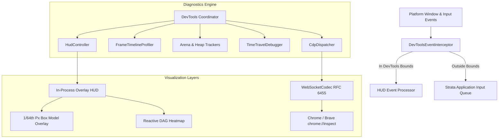
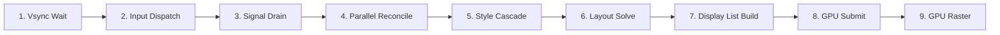

# strata-devtools

The `strata_devtools` crate provides a unified diagnostics and instrumentation suite built directly into the Project Strata runtime. It operates without external browser runtimes, embedding an in-process Heads-Up Display (HUD), DOM and component tree inspector, live Tailwind utility editor, 9-stage microsecond frame profiler, thread-local memory arena telemetry tracker, reversible time-travel debugger, reactive dependency graph visualizer, and a compliant Chrome DevTools Protocol (CDP) WebSocket bridge.

---

## Architectural Topology

The diagnostic engine intercepts events at the platform window layer, computes telemetry during every frame render loop, and bridges diagnostics both visually on-screen and remotely via RFC 6455 WebSockets:



---

## Subsystem Reference

The crate is organized into discrete functional modules:

| Module | Core Structs / Types | Functional Purpose |
| :--- | :--- | :--- |
| `hud` | `HudController`, `HudState`, `HudDockMode`, `HudTab`, `DevToolsEventInterceptor` | Overlay HUD management, window docking layouts, active tabs, and input event routing. |
| `inspector` | `ComponentMeta`, `SourceLocation`, `ReflectProp`, `PropDescriptor`, `PropValue`, `BoxModelMetrics`, `LiveTailwindEditor` | Component reflection, prop introspection, subpixel box model metrics, and real-time Tailwind class injection. |
| `profiler` | `FrameTimelineProfiler`, `FrameTimingSample`, `StageTimer`, `LayoutShiftDetector`, `TraceJsonExporter` | 9-stage microsecond render pipeline stopwatch, Cumulative Layout Shift (CLS) detection, and Chrome `trace.json` emission. |
| `memory` | `ArenaInspector`, `ArenaTelemetrySample`, `ArenaAnomaly`, `AtomTableInspector`, `HeapAllocationTracker` | Thread-local bump arena utilization monitoring, high-water mark leak detection, and string atom interning telemetry. |
| `time_travel` | `TimeTravelDebugger`, `StateSnapshot`, `SnapshotDelta`, `SnapshotId` | Deterministic reactive snapshot ring buffer, history scrubbing, step-back/forward, and state branch truncation. |
| `reactive_graph` | `ReactiveGraphSnapshot`, `ReactiveCycleGuard`, `ReactiveEdge`, `CausalTriggerTrace`, `ReRenderHeatmapLevel` | Reactive dependency DAG analysis, cycle detection guards, re-render frequency heatmaps, and trigger traces. |
| `cdp` | `CdpDispatcher`, `CdpRequest`, `CdpResponse`, `WebSocketCodec`, `WebSocketFrame`, `WebSocketOpcode` | RFC 6455 WebSocket framing and JSON-RPC 2.0 Chrome DevTools Protocol server. |

---

## In-Process Overlay HUD

The HUD renders directly atop the hardware swapchain, providing real-time telemetry and inspection without altering application layouts.

### Docking Modes and Geometry

`HudDockMode` controls the HUD placement and screen layout:

```rust
use strata_devtools::hud::{HudDockMode, HudTab, HudController};

let mut hud = HudController::new();

// Set HUD to dock at the bottom of a 1920x1080 viewport
hud.set_dock_mode(HudDockMode::DockBottom, 1920.0, 1080.0);

// Switch active diagnostic tab to Reactive Graph
hud.set_active_tab(HudTab::Reactivity);

// Toggle visibility
let is_now_visible = hud.toggle_visibility();
```

Supported docking layouts:
- `HudDockMode::DockBottom`: Anchors to the bottom of the viewport with a default height of 320px.
- `HudDockMode::DockRight`: Anchors to the right edge with a default width of 420px.
- `HudDockMode::Floating`: Free-floating draggable window within the application viewport.
- `HudDockMode::CollapsedPill`: Minimizes into an unobtrusive status badge displaying current FPS and memory RSS.

### Synthetic Event Isolation

The `DevToolsEventInterceptor` ensures that developer clicks, drags, and keypresses inside the HUD do not bleed into the underlying application:

```rust
use strata_devtools::hud::DevToolsEventInterceptor;
use strata_platform::{PlatformEvent, MouseButton};

let mut interceptor = DevToolsEventInterceptor::new();

// When HUD is visible and a click occurs inside its bounds:
let event = PlatformEvent::MouseDown { x: 50.0, y: 800.0, button: MouseButton::Left };
let consumed_by_hud = interceptor.handle_event(&event, &hud.state);
if consumed_by_hud {
    // Event handled exclusively by DevTools; do not propagate to UI components
}
```

---

## DOM and Component Tree Inspector

### Component Metadata and Prop Reflection

Components implement `ReflectProp` to expose their internal properties for runtime inspection and mutation:

```rust
use strata_devtools::inspector::{ReflectProp, PropDescriptor, PropValue, SourceLocation};

pub struct TelemetryCard {
    pub title: String,
    pub cluster_nodes: i64,
    pub latency_ms: f64,
    pub is_degraded: bool,
}

impl ReflectProp for TelemetryCard {
    fn reflect_props(&self) -> Vec<PropDescriptor> {
        vec![
            PropDescriptor {
                name: "title".to_string(),
                value: PropValue::String(self.title.clone()),
                is_readonly: false,
            },
            PropDescriptor {
                name: "cluster_nodes".to_string(),
                value: PropValue::Int(self.cluster_nodes),
                is_readonly: false,
            },
            PropDescriptor {
                name: "latency_ms".to_string(),
                value: PropValue::Float(self.latency_ms),
                is_readonly: true,
            },
            PropDescriptor {
                name: "is_degraded".to_string(),
                value: PropValue::Bool(self.is_degraded),
                is_readonly: false,
            },
        ]
    }

    fn apply_prop_mutation(&mut self, prop_name: &str, new_value: PropValue) -> Result<(), String> {
        match (prop_name, new_value) {
            ("title", PropValue::String(val)) => self.title = val,
            ("cluster_nodes", PropValue::Int(val)) => self.cluster_nodes = val,
            ("is_degraded", PropValue::Bool(val)) => self.is_degraded = val,
            _ => return Err(format!("Cannot mutate prop '{}'", prop_name)),
        }
        Ok(())
    }
}
```

### CSS Box Model Visualizer

The `BoxModelMetrics` struct calculates subpixel geometry boundaries with 1/64th pixel precision:

```rust
use strata_devtools::inspector::{BoxModelMetrics, BoxModelColors};
use strata_primitives::geom::EdgeInsets;

let metrics = BoxModelMetrics::new(
    100.0, 150.0, 300.0, 200.0,       // content x, y, width, height
    EdgeInsets::all(16.0),              // padding: 16px
    EdgeInsets::all(2.0),               // border: 2px
    EdgeInsets::symmetric(24.0, 12.0),  // margin: 24px vertical, 12px horizontal
);

let content_rect = metrics.content_box();
let padding_rect = metrics.padding_box();
let border_rect = metrics.border_box();
let margin_rect = metrics.margin_box();
```

Standard W3C DevTools overlay color constants are exposed via `BoxModelColors`:
- `BoxModelColors::MARGIN_RGBA`: Orange (`[0.976, 0.608, 0.322, 0.35]`)
- `BoxModelColors::BORDER_RGBA`: Yellow (`[0.961, 0.839, 0.471, 0.45]`)
- `BoxModelColors::PADDING_RGBA`: Emerald Green (`[0.765, 0.871, 0.671, 0.40]`)
- `BoxModelColors::CONTENT_RGBA`: Blue (`[0.553, 0.722, 0.835, 0.45]`)

### Live Tailwind Utility Editor

`LiveTailwindEditor` enables testing CSS class variations on running components in real time. Classes prefixed with `!` or `-` are removed, and new utility classes are appended:

```rust
use strata_devtools::inspector::LiveTailwindEditor;

let mut classes = vec!["flex".to_string(), "bg-slate-900".to_string(), "p-4".to_string()];

// Swap padding and background dynamically
LiveTailwindEditor::apply_class_mutation(&mut classes, "-p-4 p-8 -bg-slate-900 bg-zinc-950");

assert_eq!(classes, vec!["flex", "p-8", "bg-zinc-950"]);
```

---

## 9-Stage Microsecond Frame Profiler

Strata subdivides every rendered frame into 9 discrete pipeline stages. The `FrameTimelineProfiler` tracks microsecond timings across each stage to identify frame budget bottlenecks and jank.



### Stage Timing Sample Definition

```rust
#[repr(C)]
#[derive(Debug, Clone, Copy, PartialEq, Default)]
pub struct FrameTimingSample {
    pub frame_index: u64,
    pub vsync_wait_us: u32,
    pub input_dispatch_us: u32,
    pub signal_drain_us: u32,
    pub parallel_reconcile_us: u32,
    pub style_cascade_us: u32,
    pub layout_solve_us: u32,
    pub display_list_build_us: u32,
    pub gpu_submit_us: u32,
    pub gpu_raster_duration_us: u32,
    pub total_cpu_frame_us: u32,
    pub frame_budget_us: u32,
    pub layout_shift_score: f32,
}
```

### Cumulative Layout Shift (CLS) Detection

The `LayoutShiftDetector` computes visual stability metrics between consecutive frames using distance and impact fractions:

$$\text{Score} = \text{Impact Fraction} \times \text{Distance Fraction}$$

```rust
use strata_devtools::profiler::LayoutShiftDetector;

let score = LayoutShiftDetector::calculate_shift_score(
    0.0, 100.0, 400.0, 200.0,    // Previous bounding box
    0.0, 250.0, 400.0, 200.0,    // Current bounding box (shifted down 150px)
    1920.0, 1080.0,              // Viewport dimensions
);

if score > 0.05 {
    // Spatial layout instability detected
}
```

### Chrome `trace.json` Export

Recorded frames can be exported directly to Google Chrome's tracing format, viewable in `chrome://tracing` or `ui.perfetto.dev`:

```rust
use strata_devtools::profiler::{FrameTimelineProfiler, TraceJsonExporter};

let profiler = FrameTimelineProfiler::new(300, 120.0); // 300 frame buffer at 120 FPS
let json_trace = TraceJsonExporter::export_to_json(&profiler);
std::fs::write("strata_render_trace.json", json_trace).unwrap();
```

---

## Memory Allocator and Arena Telemetry

Strata utilizes thread-local bump arenas for high-throughput zero-allocation frame rendering. The `memory` module monitors arena capacity and string interning efficiency.

### Thread-Local Bump Arena Telemetry

```rust
use strata_devtools::memory::{ArenaInspector, ArenaTelemetrySample, ArenaAnomaly};

let mut inspector = ArenaInspector::new(85.0); // 85% capacity warning threshold

let sample = ArenaTelemetrySample::new(
    0,            // Arena ID (thread 0)
    14_500_000,   // Allocated bytes
    16_777_216,   // Total capacity (16MB)
    15_100_000,   // High-water mark
    1200,         // Frame reset count
);

if let Some(anomaly) = inspector.record_sample(sample) {
    match anomaly {
        ArenaAnomaly::NearCapacity { arena_id, usage_pct } => {
            println!("Warning: Arena {} is at {:.1}% capacity", arena_id, usage_pct);
        }
        ArenaAnomaly::ResetSkipped { arena_id, frame_count } => {
            println!("Warning: Arena {} skipped reset for {} frames", arena_id, frame_count);
        }
    }
}
```

### Atom Table Telemetry

Monitors string interning cache metrics:

```rust
use strata_devtools::memory::AtomTableInspector;

let atom_stats = AtomTableInspector::new(
    4096,         // Total unique interned string atoms
    65536,        // Memory footprint in bytes
    1_250_000,    // Cache hits
    4096,         // Cache misses
);

assert!(atom_stats.lookup_hits > 1_000_000);
```

---

## Reversible Time-Travel Debugger

The `TimeTravelDebugger` maintains a deterministic ring buffer of application reactive states, enabling developers to scrub backward and forward through past states:

```rust
use strata_devtools::time_travel::{TimeTravelDebugger, StateSnapshot};

let mut debugger = TimeTravelDebugger::new(128); // Retain 128 snapshots

// Record reactive state after cluster update
let snapshot_id = debugger.record_snapshot(
    1_700_000_000_000,
    "Cluster Nodes Scaled to 48",
    vec![(1, "48".to_string()), (2, "healthy".to_string())],
    0xDEADBEEF,
);

// Step back into the previous state
if let Some(prev_state) = debugger.step_back() {
    println!("Restored snapshot: {}", prev_state.label);
}

// Compute delta between two snapshots
if let Some(delta) = debugger.compute_delta(0, 1) {
    println!("Signal {} transitioned from {:?} to {:?}", delta.signal_id, delta.old_val, delta.new_val);
}
```

---

## Reactive Graph Inspector

The `reactive_graph` module inspects the Directed Acyclic Graph (DAG) of signals and computed memos, providing re-render frequency heatmaps and circular dependency detection:

```rust
use strata_devtools::reactive_graph::{ReactiveGraphSnapshot, ReactiveCycleGuard, ReRenderHeatmapLevel};

let mut guard = ReactiveCycleGuard::new(100); // Guard against >100 cascade iterations

// Inspect re-render intensity of a component
let heatmap_level = ReactiveGraphSnapshot::compute_heatmap_level(render_count_last_sec);
match heatmap_level {
    ReRenderHeatmapLevel::Cold => println!("Optimal: < 5 renders/sec"),
    ReRenderHeatmapLevel::Warm => println!("Moderate: 5-30 renders/sec"),
    ReRenderHeatmapLevel::Hot => println!("High: 30-60 renders/sec"),
    ReRenderHeatmapLevel::Critical => println!("Warning: Over 60 renders/sec! Review signal dependencies"),
}
```

---

## Chrome DevTools Protocol (CDP) Bridge

Strata implements an RFC 6455-compliant WebSocket server handling standard Chrome DevTools Protocol JSON-RPC requests.

### Supported CDP Domains and Methods

| CDP Domain | Method | Response / Action |
| :--- | :--- | :--- |
| `DOM` | `DOM.getDocument` | Returns the root DOM node hierarchy and component child IDs. |
| `DOM` | `DOM.highlightNode` | Triggers a visual highlight bounding box around the selected element on the running GPU canvas. |
| `CSS` | `CSS.getComputedStyleForNode` | Returns resolved CSS properties (e.g., `display: flex; box-sizing: border-box;`). |
| `Performance` | `Performance.getMetrics` | Emits engine telemetry (`LayoutCount`, `RecalcStyleCount`, `FrameDuration`). |
| `Runtime` | `Runtime.evaluate` | Evaluates expressions against the active Strata runtime context. |

### RFC 6455 WebSocket Codec

The `WebSocketCodec` parses client frames and encodes server frames with zero external dependencies:

```rust
use strata_devtools::cdp::{WebSocketCodec, WebSocketOpcode, CdpDispatcher, CdpRequest};

let dispatcher = CdpDispatcher::new();

// Incoming raw WebSocket bytes from Chrome browser
let (frame, bytes_consumed) = WebSocketCodec::decode_frame(&raw_socket_buffer).unwrap();

if let Some(response_frame) = dispatcher.handle_ws_frame(&frame) {
    // Send response frame back over TCP stream
    tcp_stream.write_all(&WebSocketCodec::encode_frame(response_frame.opcode, &response_frame.payload)).unwrap();
}
```

### Remote Inspection Workflow

1. Start your application in development mode with `--devtools`:
   ```bash
   strata dev --devtools
   ```
2. Open Google Chrome or Brave and navigate to:
   ```text
   chrome://inspect
   ```
3. Under **Remote Target**, click **Inspect** next to the Strata target process.
4. Utilize the Chrome Elements panel to inspect the pure Rust DOM and computed styles.
