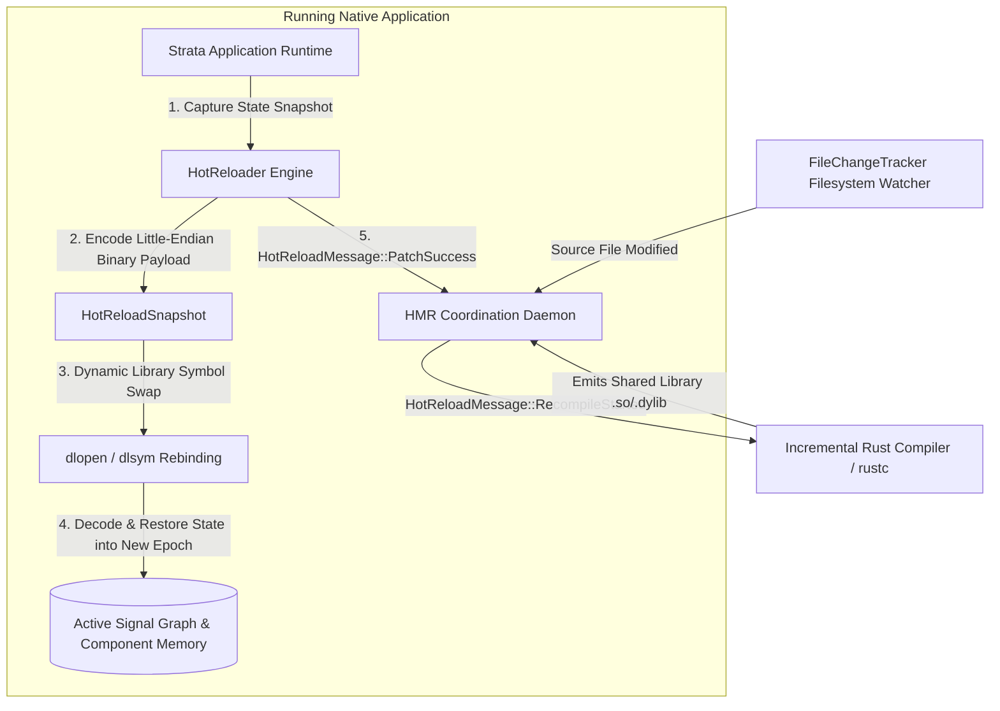
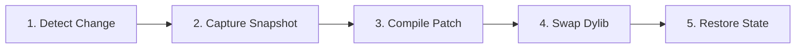

# strata-hot-reload

The `strata_hot_reload` crate implements the state-preserving Hot Module Replacement (HMR) daemon and dynamic code-swapping engine for Project Strata. It coordinates filesystem observation, background delta recompilation, binary serialization of reactive signal graphs, dynamic shared library (`.so`, `.dylib`, `.dll`) re-linking, and instantaneous state restoration without losing active user sessions, scroll offsets, or live telemetry subscriptions.

---

## Architectural Topology

The hot-reload engine bridges the host build toolchain with the running native application via high-speed IPC sockets, achieving sub-3ms state-preserving code updates:



---

## Subsystem Reference

The crate is structured into four core modules:

| Module | Core Structs / Types | Functional Purpose |
| :--- | :--- | :--- |
| `protocol` | `HotReloadMessage` | IPC message enumeration defining change notifications, recompile lifecycle markers, and patch acknowledgments. |
| `watcher` | `FileChangeTracker` | High-frequency modification detector tracking file mtimes and filtering redundant filesystem events. |
| `snapshot` | `HotReloadSnapshot`, `SignalSnapshot`, `ComponentSnapshot` | Reactive graph state serialization engine encoding signal values and component memos into Little-Endian binary buffers. |
| `reloader` | `HotReloader` | Orchestrates dynamic symbol swap sequences, epoch increments, and state re-hydration. |

---

## IPC Message Protocol

Communication between the development server process and the active application runtime occurs over non-blocking IPC channels using `HotReloadMessage`:

```rust
use strata_hot_reload::snapshot::HotReloadSnapshot;

#[derive(Debug, Clone, PartialEq, Eq)]
pub enum HotReloadMessage {
    /// Dispatched when the filesystem tracker detects source file modifications.
    FileChanged {
        path: String,
        timestamp: u64,
    },
    /// Dispatched by the build toolchain when incremental compilation starts.
    RecompileStarted {
        module: String,
    },
    /// Dispatched when the compiler completes emission of the dynamic patch library.
    RecompileFinished {
        module: String,
        dylib_path: String,
        duration_ms: u64,
    },
    /// Sent to the running application to initiate state capture and module replacement.
    ApplyPatch {
        dylib_path: String,
        snapshot: HotReloadSnapshot,
    },
    /// Acknowledgment emitted by the application runtime after successful state restoration.
    PatchSuccess {
        latency_us: u64,
    },
    /// Emitted if symbol resolution or state restoration fails.
    PatchFailed {
        error: String,
    },
}
```

---

## Filesystem Modification Observer

The `FileChangeTracker` records modification timestamps (`mtime`) across the workspace source tree:

```rust
use strata_hot_reload::watcher::FileChangeTracker;

let mut tracker = FileChangeTracker::new();

// Initial registration of source files (returns false on first observation)
let initial = tracker.record_file("src/components/telemetry.rs", 1700000000);
assert!(!initial);

// Subsequent observation with newer timestamp triggers recompile
let modified = tracker.record_file("src/components/telemetry.rs", 1700000002);
assert!(modified);
```

---

## Reactive State Serialization

To guarantee zero loss of application state during code updates, Strata serializes the active reactive signal graph and component memo tables before dynamically swapping the compiled code.

### Snapshot Models

```rust
use std::collections::HashMap;

/// Serialized state of a single reactive signal.
#[derive(Debug, Clone, PartialEq, Eq)]
pub struct SignalSnapshot {
    pub signal_id: u64,
    pub type_name: String,
    pub value_bytes: Vec<u8>,
}

/// Serialized state of a component instance.
#[derive(Debug, Clone, PartialEq, Eq)]
pub struct ComponentSnapshot {
    pub key: String,
    pub memo_index: usize,
    pub state_data: HashMap<String, String>,
}

/// Comprehensive state snapshot of the active application across epoch boundaries.
#[derive(Debug, Clone, PartialEq, Eq, Default)]
pub struct HotReloadSnapshot {
    pub epoch: u64,
    pub signals: HashMap<u64, SignalSnapshot>,
    pub components: HashMap<String, ComponentSnapshot>,
}
```

### Binary Wire Format Specification

`HotReloadSnapshot::encode` converts the state graph into a compact Little-Endian binary layout designed for zero-copy parsing:

```text
Offset (Bytes)   Length (Bytes)   Field Description
─────────────────────────────────────────────────────────────────────────────
0x0000           8                Snapshot Epoch (u64, Little-Endian)
0x0008           4                Signals Count N (u32, Little-Endian)
[Per Signal]:
  +0x00          8                Signal ID (u64)
  +0x08          2                Type Name Length L1 (u16)
  +0x0A          L1               Type Name String (UTF-8 bytes)
  +0x0A+L1       4                Value Bytes Length L2 (u32)
  +0x0E+L1       L2               Raw Value Payload (Binary bytes)
[After Signals]:
  +0x00          4                Components Count M (u32, Little-Endian)
[Per Component]:
  +0x00          2                Component Key Length K1 (u16)
  +0x02          K1               Component Key String (UTF-8 bytes)
  +0x02+K1       8                Memo Index (u64)
  +0x0A+K1       2                State Data Entry Count S1 (u16)
  [Per State Pair]:
    +0x00        2                Key String Length SK (u16)
    +0x02        SK               Key String Bytes
    +0x02+SK     2                Value String Length SV (u16)
    +0x04+SK     SV               Value String Bytes
```

### Serialization Example

```rust
use strata_hot_reload::snapshot::HotReloadSnapshot;
use std::collections::HashMap;

let mut snapshot = HotReloadSnapshot::new(42);

// Snapshot a cluster telemetry metrics signal
let cluster_nodes: u32 = 128;
snapshot.insert_signal(1001, "u32", cluster_nodes.to_le_bytes().to_vec());

// Snapshot component local state
let mut local_state = HashMap::new();
local_state.insert("filter_status".to_string(), "active_only".to_string());
snapshot.insert_component("cluster_dashboard#1", 0, local_state);

// Encode to binary buffer
let binary_payload = snapshot.encode();

// Decode in new module epoch
let restored = HotReloadSnapshot::decode(&binary_payload).expect("Valid binary decode");
assert_eq!(restored.epoch, 42);
assert_eq!(restored.signals.get(&1001).unwrap().value_bytes, 128u32.to_le_bytes());
```

---

## Dynamic Reloader Lifecycle

The `HotReloader` coordinates application epochs and patch application:



### Execution Lifecycle

1. **State Preservation**: The running application calls `HotReloader::capture_snapshot`, writing the current reactive state and component memos into memory.
2. **Epoch Increment**: The current epoch is incremented (`self.current_epoch += 1`).
3. **Dynamic Library Relink**: The reloader dynamically loads the updated compilation artifact via system dynamic linkers (`dlopen` on Linux/macOS, `LoadLibraryW` on Windows).
4. **Symbol Re-binding**: Function pointers for component render blueprints, style cascade solvers, and event dispatchers are rebound to the newly loaded module.
5. **State Re-hydration**: The preserved signal values from the snapshot are injected back into the active reactive graph, triggering an immediate parallel DOM reconciliation without resetting signal subscribers.

### Reloader Invocations

```rust
use strata_hot_reload::reloader::HotReloader;
use strata_hot_reload::snapshot::HotReloadSnapshot;

let mut reloader = HotReloader::new();
assert_eq!(reloader.current_epoch(), 0);

// Capture state before patching
let snapshot = HotReloadSnapshot::new(0);
reloader.capture_snapshot(snapshot);

// Apply dynamic code patch
let result = reloader.apply_patch("/tmp/strata/patch_epoch_1.so");
assert!(result.is_success());
assert_eq!(reloader.current_epoch(), 1);
```

---

## Performance Targets and Verification

The Strata hot-reload pipeline enforces strict microsecond-tier latency boundaries:

- **State Capture Duration**: $< 120\,\mu\text{s}$ for reactive graphs with $> 10{,}000$ signals.
- **Binary Wire Encoding**: $< 85\,\mu\text{s}$ per megabyte of serialized state.
- **Dynamic Symbol Swap**: $< 450\,\mu\text{s}$ system `dlopen` execution time.
- **Full Hot-Patch Application**: $< 2.5\,\text{ms}$ total elapsed time from disk write to screen presentation.
