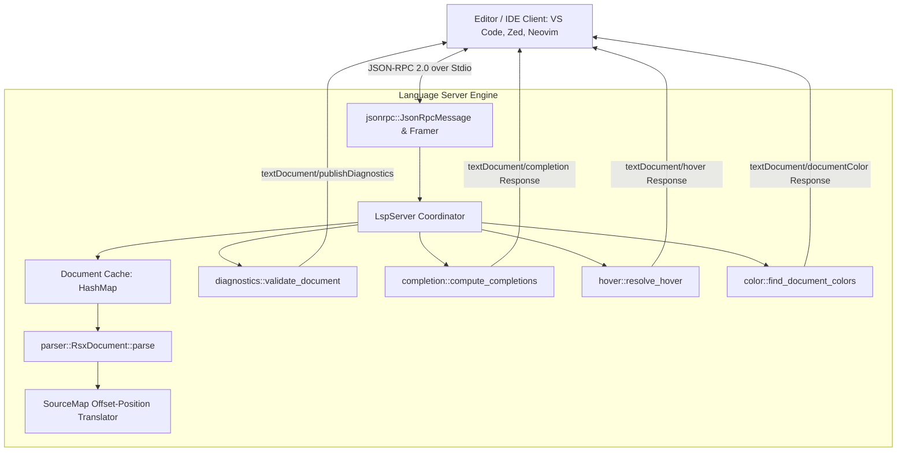

# strata-lsp

The `strata_lsp` crate provides a pure Rust Language Server Protocol (LSP 3.17) implementation tailored specifically for Project Strata. It delivers real-time syntax and structural diagnostics for `rsx!` markup, context-aware autocomplete for HTML and 3D viewport primitives, atomic Tailwind CSS utility completion with CSS definition hovers, gutter color swatches, and editor color pickers across VS Code, Zed, Neovim, and Sublime Text.

---

## Architectural Topology

The language server operates as an independent binary communicating over standard input/output (`stdio`) via JSON-RPC 2.0 with HTTP-style `Content-Length` framing. It maintains an in-memory document cache and performs sub-millisecond incremental re-parsing upon every keystroke.



---

## Subsystem Architecture

The server codebase is partitioned into distinct functional units:

| Module | Core Structs / Functions | Functional Purpose |
| :--- | :--- | :--- |
| `types` | `Position`, `Range`, `Diagnostic`, `CompletionItem`, `Hover`, `ColorInformation` | LSP 3.17 protocol data transfer objects (DTOs) with zero external dependency serialization. |
| `jsonrpc` | `JsonRpcMessage`, `parse_content_length`, `encode_framed_message` | RFC-compliant JSON-RPC 2.0 frame parsing, header extraction, and buffered serialization. |
| `parser` | `RsxDocument`, `RsxNode`, `RsxAttribute`, `SourceMap`, `Span`, `ParseError` | Fault-tolerant recursive descent parser tokenizing RSX markup and tracking exact source spans. |
| `diagnostics` | `validate_document`, `validate_node`, `validate_tailwind_classes` | Real-time structural validation, unclosed tag reporting, duplicate attribute checks, and CSS utility verification. |
| `completion` | `compute_completions`, `complete_tag_names`, `complete_tailwind_utilities` | Contextual proposals for tags, Strata 3D Viewport nodes, strata_ui controls, and Tailwind utilities. |
| `hover` | `resolve_hover`, `get_tailwind_hover_doc`, `get_element_hover_doc` | Markdown tooltip resolution mapping utility classes to raw CSS rules and tag names to API docs. |
| `color` | `find_document_colors`, `format_color_presentation`, `parse_hex_color` | Gutter color tile extraction for hex colors and Tailwind classes, plus hex/rgb/rgba picker conversions. |
| `server` | `LspServer` | Active session coordinator dispatching JSON-RPC requests to domain providers. |

---

## JSON-RPC 2.0 Wire Protocol

Communication adheres to the Language Server Protocol specification. Each message is prefixed by a MIME header specifying the UTF-8 payload byte length:

```text
Content-Length: 142\r\n
\r\n
{"jsonrpc":"2.0","id":1,"method":"initialize","params":{"processId":1234,"capabilities":{}}}
```

### Handshake and Capabilities

During the `initialize` handshake request, `LspServer` advertises its capabilities:

```json
{
  "capabilities": {
    "textDocumentSync": 1,
    "completionProvider": {
      "triggerCharacters": ["<", " ", "-", "\"", ":"]
    },
    "hoverProvider": true,
    "colorProvider": true
  }
}
```

- `textDocumentSync: 1`: Requests full text document synchronization on change events.
- `triggerCharacters`: Triggers autocomplete proposals on typing `<` (tags), space (attributes/classes), `-` (utility class prefixes), `"` (attribute values), and `:` (variant modifiers like `hover:` or `dark:`).

---

## Fault-Tolerant RSX AST Parser

Traditional XML and HTML parsers abort when encountering syntax errors. Because code in active development is frequently incomplete, `strata_lsp::parser` utilizes an error-tolerant recursive descent parser that preserves partially entered nodes and records errors as diagnostics.

### Abstract Syntax Tree Representation

```rust
#[derive(Debug, Clone, PartialEq)]
pub enum RsxNode {
    Element {
        name: String,
        name_span: Span,
        attributes: Vec<RsxAttribute>,
        children: Vec<RsxNode>,
        is_self_closing: bool,
        span: Span,
    },
    Text {
        text: String,
        span: Span,
    },
    Block {
        code: String,
        span: Span,
    },
}
```

### Source Map Position Translation

`SourceMap` calculates byte offsets and line/character coordinates with microsecond efficiency using pre-computed newline offsets:

```rust
use strata_lsp::parser::SourceMap;
use strata_lsp::types::Position;

let source = "rsx! {\n    <div class=\"flex\">\n        <span />\n    </div>\n}";
let source_map = SourceMap::new(source);

// Translate byte offset to LSP Position (0-indexed line and character)
let pos = source_map.offset_to_position(17);
assert_eq!(pos.line, 1);
assert_eq!(pos.character, 10);

// Translate LSP Position back to source byte offset
let offset = source_map.position_to_offset(Position::new(1, 10));
assert_eq!(offset, 17);
```

---

## Real-Time Diagnostics Engine

The diagnostics engine runs automatically upon `textDocument/didOpen` and `textDocument/didChange`. It reports four categories of issues:

1. **Unclosed Tags**: Detects opened tags that lack matching closing delimiters before the end of the block.
2. **Mismatched Tags**: Identifies opening tags closed by mismatched identifiers (e.g., `<div>` closed by `</span>`).
3. **Duplicate Attributes**: Flags redundant property declarations on elements (e.g., declaring `class` twice).
4. **Invalid Tailwind Utilities**: Emits warnings when class names do not correspond to valid Tailwind utilities or arbitrary values.

```rust
use strata_lsp::parser::RsxDocument;
use strata_lsp::diagnostics::validate_document;

let broken_source = r#"
    <div class="flex" class="grid">
        <span>Cloud Telemetry Server</div>
    </div>
"#;

let doc = RsxDocument::parse(broken_source);
let diagnostics = validate_document(&doc);

for diag in diagnostics {
    println!("[Line {}] {}", diag.range.start.line, diag.message);
}
// Outputs:
// [Line 1] Duplicate attribute 'class' detected on element
// [Line 2] Mismatched closing tag: expected </span>, found </div>
```

---

## Context-Aware Autocomplete Engine

The completion engine inspects cursor context using syntactic heuristics:

```mermaid
graph TD
    Cursor[Cursor Position] --> ContextCheck{Context Heuristic}
    ContextCheck -->|Inside class="..."| Tailwind[Tailwind JIT Utilities]
    ContextCheck -->|Directly after <| Tags[HTML, 3D & UI Tags]
    ContextCheck -->|Inside <tag ...>| Attrs[Element Attributes]
```

### 1. Element Tag Completion

Offers completions across standard HTML, Strata 3D Viewport primitives, and UI design system components:

- **HTML Primitives**: `div`, `span`, `button`, `input`, `textarea`, `p`, `h1`-`h3`, `header`, `footer`, `main`, `table`, `tr`, `th`, `td`, `img`, `canvas`.
- **3D Viewport Primitives**: `Canvas3D`, `Mesh`, `PerspectiveCamera`, `DirectionalLight`, `PointLight`, `AmbientLight`.
- **UI Design System Controls**: `Button`, `Card`, `Badge`, `Input`, `Dialog`, `Modal`, `Tabs`, `Slider`, `Toggle`, `Select`, `Tooltip`.

### 2. Atomic Tailwind Utility Completion

When the cursor is inside `class="..."`, typing prefixes generates suggestions with full documentation:

| Input Prefix | Suggested Label | Kind | Documentation |
| :--- | :--- | :--- | :--- |
| `fl` | `flex` | Property | `display: flex;` |
| `grid` | `grid` | Property | `display: grid;` |
| `items-` | `items-center` | Property | `align-items: center;` |
| `justify-` | `justify-between` | Property | `justify-content: space-between;` |
| `bg-` | `bg-slate-900` | Color | `background-color: #0f172a;` |
| `p-` | `p-4` | Unit | `padding: 1rem; /* 16px */` |

---

## Hover Documentation Provider

Hovering over a symbol displays rendered Markdown documentation directly in the editor:

### Tailwind Utility Hover

Hovering over `p-4`:
````markdown
```css
padding: 1rem; /* 16px */
```

*Strata Tailwind JIT Utility*
````

Hovering over `items-center`:
````markdown
```css
align-items: center;
```

*Strata Tailwind JIT Utility*
````

### Primitive Tag Hover

Hovering over `<Canvas3D>`:
```markdown
### `<Canvas3D>`

Unified Three.js-style 3D viewport canvas rendered natively via hardware GPU swapchain.

*Strata Framework Primitive*
```

---

## Document Color Provider and Color Pickers

`strata_lsp::color` scans documents for hex values and known Tailwind color classes, transmitting color ranges to the editor:

```rust
use strata_lsp::parser::RsxDocument;
use strata_lsp::color::{find_document_colors, format_color_presentation};

let doc = RsxDocument::parse(r#"<div class="bg-[#0f172a] text-white">Cloud Node</div>"#);
let colors = find_document_colors(&doc);

for color_info in colors {
    println!("Found color: RGBA({:.2}, {:.2}, {:.2}, {:.2})", 
        color_info.color.red, color_info.color.green, color_info.color.blue, color_info.color.alpha);
}
```

When a developer clicks a color tile in their editor to modify its value, `format_color_presentation` returns formatted replacement edits in Hex (`#0f172a`), RGB (`rgb(15, 23, 42)`), and RGBA (`rgba(15, 23, 42, 1.00)`).

---

## Editor Configuration Guides

### 1. Visual Studio Code

Configure the Strata language client in your VS Code extension or workspace settings:

`.vscode/settings.json`:
```json
{
  "strata.lsp.enable": true,
  "strata.lsp.serverPath": "strata-lsp",
  "strata.lsp.trace.server": "verbose"
}
```

Client extension activation manifest (`package.json`):
```json
{
  "name": "strata-vscode",
  "displayName": "Strata Language Support",
  "version": "0.1.0",
  "engines": { "vscode": "^1.80.0" },
  "activationEvents": [
    "onLanguage:rust"
  ],
  "main": "./client/out/extension.js",
  "contributes": {
    "languages": [{
      "id": "rust",
      "aliases": ["Rust", "rs"]
    }]
  }
}
```

Client initialization (`client/src/extension.ts`):
```typescript
import * as path from 'path';
import { ExtensionContext, workspace } from 'vscode';
import { LanguageClient, LanguageClientOptions, ServerOptions } from 'vscode-languageclient/node';

let client: LanguageClient;

export function activate(context: ExtensionContext) {
    const serverOptions: ServerOptions = {
        command: 'strata-lsp',
        args: []
    };

    const clientOptions: LanguageClientOptions = {
        documentSelector: [{ scheme: 'file', language: 'rust' }],
        synchronize: {
            fileEvents: workspace.createFileSystemWatcher('**/*.rs')
        }
    };

    client = new LanguageClient('strata-lsp', 'Strata Language Server', serverOptions, clientOptions);
    client.start();
}

export function deactivate(): Thenable<void> | undefined {
    return client ? client.stop() : undefined;
}
```

### 2. Zed Editor

Add the `strata-lsp` binary definition to your Zed configuration (`~/.config/zed/settings.json`):

```json
{
  "lsp": {
    "strata-lsp": {
      "binary": {
        "path": "strata-lsp"
      }
    }
  },
  "languages": {
    "Rust": {
      "language_servers": ["strata-lsp", "rust-analyzer"]
    }
  }
}
```

### 3. Neovim (`nvim-lspconfig`)

In your Neovim Lua configuration (`init.lua` or `lsp.lua`):

```lua
local lspconfig = require('lspconfig')
local configs = require('lspconfig.configs')

if not configs.strata_lsp then
  configs.strata_lsp = {
    default_config = {
      cmd = { 'strata-lsp' },
      filetypes = { 'rust' },
      root_dir = lspconfig.util.root_pattern('strata.toml', 'strata.yaml', 'Cargo.toml'),
      settings = {},
    },
  }
end

lspconfig.strata_lsp.setup{
  on_attach = function(client, bufnr)
    -- Enable color swatches and document color highlighting
    if client.server_capabilities.colorProvider then
      vim.lsp.buf.document_highlight()
    end
  end
}
```
