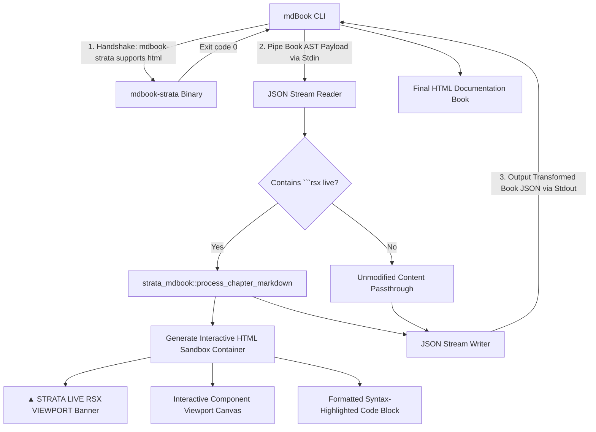

# strata-mdbook

The `strata_mdbook` crate provides the official mdBook preprocessor (`mdbook-strata`) for authoring interactive documentation books with embedded live Project Strata playgrounds, reactive component sandboxes, and hardware-accelerated 120 FPS UI viewports.

---

## Architectural Topology

The preprocessor integrates into the mdBook compilation pipeline as an external binary communicating over standard I/O via JSON serialization:



---

## Preprocessor Lifecycle and Handshake Protocol

When mdBook builds documentation, it executes registered preprocessors twice:

1. **Renderer Capability Handshake**:
   mdBook executes:
   ```bash
   mdbook-strata supports html
   ```
   The binary inspects arguments. If the requested renderer is `html`, it exits immediately with status code `0`, confirming support.
2. **Payload Processing**:
   mdBook pipes the complete book AST as a two-element JSON array over standard input:
   ```json
   [
     { "root": "/path/to/book", "config": { ... } },
     { "sections": [ { "Chapter": { "name": "...", "content": "..." } } ] }
   ]
   ```
   `mdbook-strata` parses chapters, applies transformation rules to content fields, and writes the updated JSON back to standard output.

---

## Live RSX Code Block Syntax

Technical documentation authors embed live interactive preview sandboxes using the ````rsx live` code fence:

````markdown
# Cloud Infrastructure Metrics Card

The following component renders real-time telemetry from cluster monitoring nodes:

```rsx live
<div class="flex flex-col p-6 bg-slate-900 border border-slate-800 rounded-lg w-96">
    <div class="flex items-center justify-between mb-4">
        <span class="text-xs font-semibold text-sky-400">CLUSTER AP-SOUTH-1</span>
        <span class="px-2 py-0.5 text-xs bg-emerald-500/20 text-emerald-300 rounded">HEALTHY</span>
    </div>
    <div class="text-3xl font-bold text-white mb-1">99.98%</div>
    <div class="text-xs text-slate-400">Edge Gateway Ingress Availability</div>
</div>
```
````

### Generated Container DOM Structure

`strata_mdbook::process_chapter_markdown` transforms the markdown fence into a self-contained, theme-aware preview widget:

```html
<div class="strata-live-preview border border-[#27272a] rounded-lg overflow-hidden my-4 bg-[#08090a]">
    <div class="preview-header px-4 py-2 bg-[#0f1012] border-b border-[#27272a] flex items-center justify-between text-xs font-mono text-[#a1a1aa]">
        <span class="font-bold text-[#38bdf8]">▲ STRATA LIVE RSX VIEWPORT</span>
        <span class="text-[#10b981]">120 FPS REACTIVE</span>
    </div>
    <div class="preview-canvas p-6 flex items-center justify-center bg-[#090a0d]">
        <!-- Interactive Render Mount Target -->
        <div class="flex flex-col p-6 bg-slate-900 border border-slate-800 rounded-lg w-96">
            ...
        </div>
    </div>
    <div class="preview-code bg-[#08090a] p-4 text-xs font-mono border-t border-[#27272a]">
        <pre><code class="language-rust">rsx! {
    <div class="flex flex-col p-6 bg-slate-900 border border-slate-800 rounded-lg w-96">
        ...
    </div>
}</code></pre>
    </div>
</div>
```

---

## Configuring `book.toml`

To activate the preprocessor in any mdBook project, add `[preprocessor.strata]` to `book.toml`:

```toml
[book]
authors = ["Strata Systems Team"]
language = "en"
multilingual = false
src = "src"
title = "Strata Framework Developer Reference"

[preprocessor.strata]
command = "mdbook-strata"

[output.html]
additional-css = ["theme/strata-preview.css"]
additional-js = ["theme/strata-runtime.js"]
git-repository-url = "https://github.com/larvance/strata"
```

---

## Programmatic Library Usage

The preprocessor core can also be invoked as a library within custom documentation pipelines:

```rust
use strata_mdbook::process_chapter_markdown;

let markdown_input = r#"
# Server Telemetry Overview

```rsx live
<div class="p-4 bg-zinc-900 text-white rounded">
    <span>48 Active Nodes</span>
</div>
```
"#;

let processed_html = process_chapter_markdown(markdown_input);
assert!(processed_html.contains("strata-live-preview"));
assert!(processed_html.contains("▲ STRATA LIVE RSX VIEWPORT"));
```
