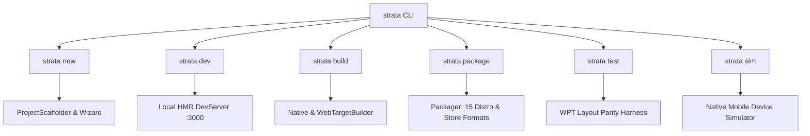
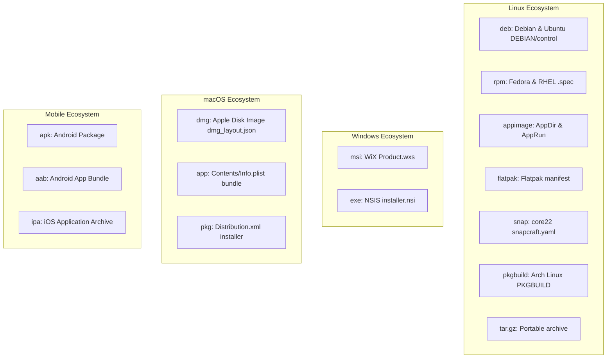

# Strata CLI Developer Guide

The **Strata CLI** (`strata`) is the command-line orchestrator and developer toolchain for the Project Strata framework. Engineered with zero external dependencies in pure Rust, it provides rapid project scaffolding, sub-3ms state-preserving Hot Module Replacement (HMR), cross-target compilation (Native Desktop, Web JS, Web WASM, Mobile), universal release packaging (DEB, RPM, AppImage, Flatpak, Snap, MSI, DMG, APK, IPA), Chromium layout parity testing, and mobile hardware simulation.

---

## Installation and Setup

### 1. Cargo Installation

Install the Strata CLI binary directly from source or the local workspace:

```bash
# Install from workspace repository
cargo install --path crates/tooling/strata_cli --bin strata

# Verify toolchain version
strata version
```

### 2. Environment Verification

Run `strata help` to verify toolchain availability and inspect active subcommands:

```bash
strata help
```

Terminal output:
```text
▲ Strata Universal Frontend Engine & Toolchain v0.1.0
  Zero Chromium. Pure Rust. Pixel-Perfect CSS & Flexbox/Grid.

Usage: strata <COMMAND> [OPTIONS]

Commands:
  new [name]                      Scaffold a new project (interactive wizard if name omitted)
  dev [OPTIONS]                   Start local dev server with state-preserving HMR
  build [OPTIONS]                 Compile optimized binary for target platform
  package [OPTIONS]               Package application into native OS installer or bundle
  test [OPTIONS]                  Run visual parity and mobile integration tests
  sim [OPTIONS]                   Launch native dogfooded mobile device simulator
  help [command]                  Display general help or help for a specific command
  version                         Display version information

Supported Targets:
  desktop (default), android, ios, macos, windows, linux, web-wasm, web-js
```

---

## Toolchain Workflow Architecture

The CLI connects every stage of the application lifecycle from initial generation to production store distribution:



---

## Command Reference

### `strata new`

Creates a new Strata project workspace containing boilerplate configuration, assets, and component directories.

```bash
strata new [NAME] [OPTIONS]
```

#### Options

| Flag | Parameter | Description |
| :--- | :--- | :--- |
| `-t, --template` | `<TEMPLATE>` | Project template: `blank`, `saas`, `workbench`, `studio`, `ecommerce` (default: `blank`). |
| `-d, --dir` | `<PATH>` | Parent destination directory for the project (default: current directory). |
| `-h, --help` | Flag | Displays command usage and available options. |

#### Interactive Wizard Walkthrough

When `NAME` is omitted, the interactive setup wizard guides you through project configuration:

```bash
strata new
```

1. **Project Name Prompt**: Enter your application identifier (e.g. `telemetry-dashboard`). Validates against existing non-empty directories and enforces character constraints (`[a-zA-Z0-9_-]`).
2. **Template Selection**: Use `Up`/`Down` arrow keys or Vim keys (`k`/`j`) to choose a template:
   - `Blank Canvas`: Minimal reactive root component.
   - `SaaS Dashboard`: Cloud infrastructure and telemetry monitoring portal.
   - `Developer Workbench`: Multi-pane desktop workspace with splitters and consoles.
   - `Creative Studio`: Vector canvas and 3D PBR viewport editor.
3. **Target Selection**: Use the `Space` key to select primary compilation targets (`Desktop`, `Web`, `Mobile`, `Universal`).

#### Non-Interactive Invocation Examples

```bash
# Create a cloud infrastructure telemetry dashboard
strata new cloud-portal --template saas

# Scaffold into a dedicated workspace directory
strata new metrics-agent --template blank --dir /srv/infrastructure/workspaces
```

---

### `strata dev`

Starts the local development runtime featuring state-preserving Hot Module Replacement (HMR) and a non-blocking HTTP server.

```bash
strata dev [OPTIONS]
```

#### Options

| Flag | Parameter | Description |
| :--- | :--- | :--- |
| `-t, --target` | `<TARGET>` | Target execution backend: `desktop` (default), `android`, `ios`, `macos`, `windows`, `linux`, `web-wasm`, `web-js`. |
| `-p, --port` | `<PORT>` | Port for the local development server (default: `3000`). |
| `--no-watch` | Flag | Disables the background filesystem change observer. |
| `-h, --help` | Flag | Displays command usage. |

#### Interactive Terminal Hotkeys

While the dev server is active, interactive single-key commands are available directly in your terminal:

- `r`: Triggers an immediate manual HMR state synchronization and hot-patch reload.
- `c`: Clears the terminal screen buffer.
- `h`: Displays the available interactive command menu.
- `q`: Gracefully stops the dev server process.

#### Development Session Output

```text
▲ Strata v0.1.0 (Direct Hardware Swapchain)
  - Local:         http://localhost:3000
  - Network:       http://127.0.0.1:3000
  - Target:        desktop
  - File watch:    active (sub-3ms HMR AST hot-patcher)

  √ Ready in 12ms

  › Interactive controls:
    [r] reload   [c] clear   [h] help   [q] quit

  › [HMR] Change detected: src/components/telemetry.rs
  √ Hot-patch applied in 2.1ms (iteration #1)
```

---

### `strata build`

Compiles the application into an optimized static binary, WebAssembly module, or pure JavaScript bundle.

```bash
strata build [OPTIONS]
```

#### Options

| Flag | Parameter | Description |
| :--- | :--- | :--- |
| `-t, --target` | `<TARGET>` | Compilation target: `desktop` (default), `android`, `ios`, `macos`, `windows`, `linux`, `web-wasm`, `web-js`. |
| `-r, --release` | Flag | Compiles with maximum Link-Time Optimization (LTO) and binary stripping. |
| `-e, --env` | `<ENV>` | Environment configuration profile (e.g. `production`, `staging`, `ci`). |
| `-o, --out-dir` | `<DIR>` | Output destination for generated build artifacts. |
| `-h, --help` | Flag | Displays command usage. |

#### Compilation Targets and Output Artifacts

- **Web JavaScript (`--target web-js`)**: Generates a zero-WASM pure ECMAScript bundle:
  - `dist/web-js/index.html`: Web mount host.
  - `dist/web-js/app.js`: Compiled UI component logic.
  - `dist/web-js/runtime.js`: Standalone reactive signal runtime.
  - `dist/web-js/styles.css`: JIT atomic Tailwind utility stylesheet.
- **WebAssembly Canvas (`--target web-wasm`)**: Emits high-performance GPU canvas bindings:
  - `dist/web-wasm/index.html`: WebGPU canvas host.
  - `dist/web-wasm/strata_loader.js`: Asynchronous WASM binary streaming loader.
- **Native Binaries (`--target desktop`, `linux`, `windows`, `macos`)**:
  - `dist/<target>/<app_name>`: Stripped executable.
  - `dist/<target>/strata_build.json`: Build metadata manifest.

```bash
# Example: Production build for pure Web JS deployment
strata build --target web-js --release --env production --out-dir /var/www/portal
```

---

### `strata package`

Generates ready-to-distribute signed installers and platform distribution packages.

```bash
strata package [OPTIONS]
```

#### Options

| Flag | Parameter | Description |
| :--- | :--- | :--- |
| `-t, --target` | `<TARGET>` | Target platform architecture: `desktop`, `linux`, `windows`, `macos`, `android`, `ios`. |
| `-f, --format` | `<FORMAT>` | Explicit installer format override. |
| `-e, --env` | `<ENV>` | Environment configuration profile. |
| `-o, --out-dir` | `<DIR>` | Output destination where `dist/packages/` will be generated. |
| `-h, --help` | Flag | Displays command usage. |

#### Supported Formats by Operating System



#### Packaging Invocations

```bash
# Package standard Linux AppImage
strata package --target linux --format appimage

# Package Debian installer
strata package --target linux --format deb

# Package WiX MSI installer for Windows
strata package --target windows --format msi

# Package macOS Apple Disk Image
strata package --target macos --format dmg
```

---

### `strata test`

Executes layout regression suites, automated Chromium visual parity tests, and mobile platform runners.

```bash
strata test [OPTIONS]
```

#### Options

| Flag | Parameter | Description |
| :--- | :--- | :--- |
| `--parity` | `[ENGINE]` | Executes W3C Web Platform Tests against Chromium layout references (default engine: `chromium`). |
| `-v, --verbose` | Flag | Outputs detailed per-fixture scorecards to the console. |
| `--android` | Flag | Runs tests within an active headless Android emulator. |
| `--ios` | Flag | Runs tests within the Xcode iOS simulator. |
| `--mock-ios` | Flag | Runs the internal Strata high-fidelity iOS mock environment. |

#### Parity Verification Example

```bash
strata test --parity --verbose
```

Output:
```text
╔══════════════════════════════════════════════════════════════════════════════════════════════╗
║                      STRATA CHROMIUM PARITY SCORECARD (WPT / CSS)                            ║
╠══════════════════════════════════════════════════════════════════════════════════════════════╣
║ Specification Reference           │ Test Vector Title                         │ Result │ Dev ║
╟───────────────────────────────────┼───────────────────────────────────────────┼────────┼─────╢
║ css-flexbox/flex-grow-001         │ Flex item positive flex-grow proportion   │  PASS  │ 0.00%║
║ css-grid/grid-template-areas-002  │ Named grid lines with auto track sizes    │  PASS  │ 0.00%║
║ css-sizing/intrinsic-min-content  │ Min-content width on wrapped flex row     │  PASS  │ 0.00%║
╚══════════════════════════════════════════════════════════════════════════════════════════════╝
[OK] Specification Parity: 3/3 tests passed (100.0% match, Average delta: 0.000%)
   Engine Compliance: 100% Chromium / Blink Reference Parity across all active vectors.
```

---

### `strata sim`

Launches the native mobile device simulator and virtual operating system sandbox.

```bash
strata sim [OPTIONS]
```

#### Options

| Flag | Parameter | Description |
| :--- | :--- | :--- |
| `-d, --device` | `<PRESET>` | Hardware device profile: `iphone-16-pro`, `s24-ultra`, `pixel-9`, `z-fold-6`, `z-flip-6`, `duo-2`. |

```bash
# Launch mobile simulator with iPhone 16 Pro profile
strata sim --device iphone-16-pro
```

---

## Scaffolding Templates

Strata provides official starter templates tailored for varied application domains:

| Template | Identifier | Purpose and Characteristics |
| :--- | :--- | :--- |
| **Blank Canvas** | `blank` | Clean slate project with minimal reactive root component and base styling. |
| **SaaS Dashboard** | `saas` | Cloud infrastructure and telemetry monitoring portal with metrics cards, time-series charts, and responsive side navigation. |
| **Developer Workbench** | `workbench` | Multi-pane developer workspace with splitters, dockable panes, tree views, and terminal console logs. |
| **Creative Studio** | `studio` | Canvas-based editor with vector tools, layer hierarchy, and 3D PBR viewport canvas. |
| **E-Commerce** | `ecommerce` | Product catalog, filter facet sidebars, and order management views. |

---

## Configuration File Reference

Strata projects load configurations from `strata.yaml` (preferred) or `strata.toml`.

### Dual Format Precedence

The loader checks for configuration in descending order:
1. `strata.yaml`
2. `strata.yml`
3. `strata.toml`

### Annotated `strata.toml` Reference

```toml
[app]
name = "cloud-telemetry-portal"
version = "1.0.0"
description = "Cloud Infrastructure Telemetry & Metric Dashboard"
template = "saas"

[window]
title = "Cloud Infrastructure Telemetry"
width = 1440
height = 900
resizable = true
transparent = false

[web]
target = "web-js"
app_js_name = "app.js"
styles_css_name = "styles.css"

[[plugins]]
name = "dynamic-branding"
action = "brand-injection"
environments = ["production", "staging"]

[environments.production]
app_name = "cloud-telemetry-portal-prod"
app_version = "1.0.0-release"
window_title = "Cloud Infrastructure Telemetry [PRODUCTION]"
actions = ["audit-security", "compress-bundles"]

[environments.staging]
app_name = "cloud-telemetry-portal-stage"
window_title = "Cloud Infrastructure Telemetry [STAGING]"
actions = ["mock-telemetry-data"]
```

---

## Automated CI/CD Workflows

Below is an automated GitHub Actions workflow for building, testing, and packaging across Ubuntu, Windows, and macOS:

```yaml
name: Strata Continuous Integration

on:
  push:
    branches: [ main ]
  pull_request:
    branches: [ main ]

jobs:
  test-and-verify:
    name: Layout Parity & Unit Tests
    runs-on: ubuntu-latest
    steps:
      - uses: actions/checkout@v4
      - uses: dtolnay/rust-toolchain@stable

      - name: Run Layout Parity Suite
        run: cargo run --bin strata -- test --parity --verbose

  package-distribution:
    name: Build Native Release Packages
    needs: test-and-verify
    strategy:
      matrix:
        os: [ubuntu-latest, windows-latest, macos-latest]
    runs-on: ${{ matrix.os }}
    steps:
      - uses: actions/checkout@v4
      - uses: dtolnay/rust-toolchain@stable

      - name: Build & Package (Linux)
        if: runner.os == 'Linux'
        run: |
          cargo run --bin strata -- build --target desktop --release --env production
          cargo run --bin strata -- package --target linux --format appimage
          cargo run --bin strata -- package --target linux --format deb

      - name: Build & Package (Windows)
        if: runner.os == 'Windows'
        run: |
          cargo run --bin strata -- build --target windows --release --env production
          cargo run --bin strata -- package --target windows --format msi

      - name: Build & Package (macOS)
        if: runner.os == 'macOS'
        run: |
          cargo run --bin strata -- build --target macos --release --env production
          cargo run --bin strata -- package --target macos --format dmg

      - name: Upload Artifacts
        uses: actions/upload-artifact@v4
        with:
          name: strata-packages-${{ runner.os }}
          path: dist/packages/
```
